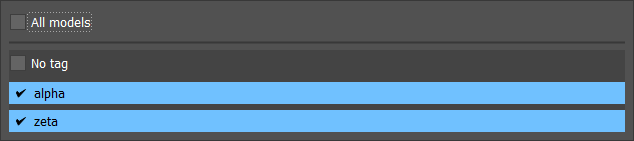
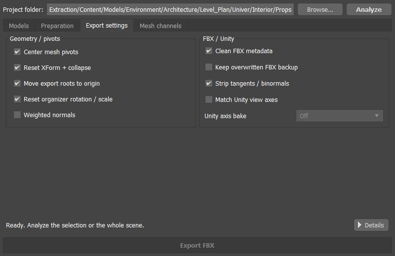

# MAX ModelBatch: illustrated user guide

**Version 1.2.1 · 3ds Max 2022-2027 · FBX workflows · examples from Max 2024**

Batch-import, prepare and export models with a dockable Max panel: create export Dummies, write one FBX per asset, import files in batches, compare UV seams, preview LODs and route models into project folders using export tags.

MAX ModelBatch is the new name of TS_UnityExport. Version 1.2.1 uses the new name, repository and plugin filename, while retaining saved settings and scene metadata. The illustrations are actual Max 2024 captures from development test scenes and retain those earlier UI labels. The workflow captures come from version 1.2.0; the rename, old scene tags/routes and real FBX export were verified in a separate Max 2024 run. All twelve SDK build variants pass their regression suites. Object names, paths, checkbox states and version labels in the captures are examples rather than recommended defaults. These earlier captures do not establish runtime compatibility of the new release in every supported Max host.

## Contents

- [1. Install and open](#install)
- [2. Your first export](#quickstart)
- [3. Create Dummies and prepare the scene](#preparation)
- [4. Work with the export table](#models)
- [5. Tags, colors and project folders](#tags)
- [6. Export settings](#settings)
- [7. Scale and Unity directions](#unity)
- [8. UV channels and vertex colors](#channels)
- [9. Display UV seams](#seams)
- [10. Preview LODs and organize layers](#lod)
- [11. Batch-import FBX files](#import)
- [12. Update and roll back](#updates)
- [13. Optional Mesh Align](#meshalign)
- [14. Saved settings and troubleshooting](#help)

<a id="install"></a>
## 1. Install and open

1. Open the [1.2.1 release](https://github.com/SashaRX/MaxModelBatch-Releases/releases/tag/v1.2.1). Download the archive **for your exact Max year**. For Max 2024, [download the standard build](https://github.com/SashaRX/MaxModelBatch-Releases/releases/download/v1.2.1/MaxModelBatch_v1.2.1_3dsMax2024.zip).
2. Close Max. Extract the archive into a permanent folder such as `C:\Tools\MaxModelBatch\2024`. The plugin file is `MaxModelBatch.dlu`. Historical releases through 1.2.0 use `TS_UnityExport.dlu`.
3. In Max, open **Customize → Configure System Paths → 3rd-Party Plug-Ins → Add**. Add the folder containing the `.dlu`, then restart Max.
4. In a renamed build, open **Scripting → MAX ModelBatch** on **Max 2022-2024**, or **MAX ModelBatch → MAX ModelBatch** on **Max 2025-2027**. The legacy menu fallback on older hosts is also **MAX ModelBatch**. In the published **1.2.0** build, the command is still **Unity FBX Exporter**, under **Scripting** or **Unity Tools**.

For the first upgrade after the repository rename, close Max and manually replace the installation. Remove `TS_UnityExport.dlu` from all scanned plugin folders before installing `MaxModelBatch.dlu`, and keep one copy for each host. Existing scene tags and settings are retained.

The standard archive includes every core feature in this guide. Experimental Mesh Align requires the separate `_MeshAlign.zip` variant. Max supplies the Qt runtime; do not copy additional Qt DLLs into the plugin folder. Manual ZIP downloads are public at MaxModelBatch-Releases. No GitHub sign-in is required.

Dock the panel wherever it suits your workspace. The **Export** tab keeps **Project folder** and **Analyze** at the top and **Export FBX** at the bottom. Four workflow pages fill the middle: **Models**, **Preparation**, **Export settings** and **Mesh channels**.


*Models: project folder, tag filter, export roots, destinations and tags. This capture shows three test roots.*

<a id="quickstart"></a>
## 2. Your first export

Place one asset's render meshes and collision meshes under one Dummy. If you already have that hierarchy, start with Analyze.

These steps describe the compact UI. In earlier releases, open **Export → Preparation** and use **Create Dummy from Selection** instead. The downloadable PDF and screenshots show that earlier UI.

1. Select the meshes of one asset in Max. Open **Export → Models**.
2. Enter an informative **Asset name**, such as `TrashCan`. Toggle **At center / At bottom** and click **Create Dummy**.
3. Set **Project folder**, the common base for all relative tag routes.
4. Click **Analyze**. With objects selected, the plugin collects their Dummy roots. With no selection, it searches Dummies throughout the scene.
5. In **Models**, check names, **Destination** and root checkboxes. Assign a tag in the last column if needed.
6. Review **Export settings** and **Mesh channels**, then click **Export FBX**.
7. Read the operation status at the bottom. Open **Details** or **Log** for errors.

Each checked root that is visible through the current tag filter produces a separate file named after its Dummy, for example `SM_TrashCan.fbx`. Its hierarchy, including `_COL` meshes, goes into that file.

Example hierarchy:

```text
SM_TrashCan                 ← export root and FBX filename
├── TrashCan_LOD0            ← most detailed alternative
├── TrashCan_LOD1
├── TrashCan_LOD2
└── TrashCan_COL             ← collision mesh
```

Do not assign a different LOD number to every part of a multipart model. Use polygon-count LOD naming when the selected objects or groups are alternative detail levels of the same asset.

<a id="preparation"></a>
## 3. Create Dummies and prepare the scene


*Earlier UI capture. In the compact UI, Dummy creation is above the Models list; scene utilities stay in Preparation. Organize LOD / COL layers works on the whole scene.*

**At center / At bottom** toggles the root's location:

| Mode | Position |
|---|---|
| At center | Center of the combined world-space geometry bounds |
| At bottom | The same X/Y center at the lowest geometry Z |

“Floor” means the bottom of the selected model, not world `Z = 0`. Creating the root preserves the geometry's world placement.

Enter a shared base name in **Asset name** or leave it blank to let the plugin choose an informative selected name. Automatic naming uses heuristics. If it finds no suitable candidate, it asks for a name. An explicit name is useful when a scene still contains names such as `Plane003`, numbers or temporary placeholders.

The root gets `SM_` without trailing `_COL` or `_LOD#`: `SM_TrashCan`. Child names lose the `SM_` prefix. **Auto LODs** gives every LOD the same base name: more polygons means a lower LOD number; equal counts use selection order. A selected group's count includes its render descendants. Collision branches are excluded and retain `_COL`. Automatic ranking supports up to ten LOD alternatives.

One **Ctrl+Z** undoes Dummy creation, naming and parenting.

| Scene tool | What it does |
|---|---|
| Normalize Dummies | Sets every Dummy helper's box size to 1×1×1 |
| Hide _COL | Hides collision branches by the `_COL` suffix; click again to show them |
| Rebuild SG from Normals | Rebuilds smoothing groups on selected Editable Poly/Mesh objects from their existing normals |
| Rebuild SG from UV | Rebuilds smoothing groups from UV seams in the base object's Max channel 1 |
| Organize LOD / COL layers | Routes the whole scene into shared LOD0, LOD1, … and COL layers |

For **Rebuild SG from UV**, UV data must be in the base object. If it exists only in a UVW Mapping or Unwrap modifier, prepare/collapse that stack first. This tool changes smoothing; UV seam display only inspects the model.

<a id="models"></a>
## 4. Work with the export table


*An expanded hierarchy shows Dummies, child objects and anticipated material-split outputs.*

- A **root checkbox** includes the asset in export. Row selection is a separate action.
- Click **Name**, **Status** or **Destination** to select that object in Max. A Dummy selects itself and all descendants, including collapsed branches. A mesh row selects the mesh itself.
- Use **Ctrl/Shift** for multiple rows. The **Tag** column opens the tag dropdown without changing scene selection.
- Analyze starts with branches collapsed. **Развернуть всё / Свернуть всё** means **Expand all / Collapse all** and toggles all hierarchy levels shown by the current filter.
- **Выбрать все / Снять все / Инвертировать выбор** mean **Select all / Clear all / Invert selection**. They change export checkboxes only for roots visible through the tag filter. Filtered-out models keep their checkboxes.
- Drag a column divider to resize it, or double-click it to fit the contents. Click a heading to sort; click again to reverse the order. Children remain under their root.

**Split materials** splits render meshes with Multi/Sub materials into meshes per material. Analyze previews the expected outputs. The button processes **all models shown by the filter, regardless of root checkboxes**. An output preview is not yet a scene object, so it cannot be selected in the viewport before the split.

Analyze populates the table; it does not export or run Split. Some bulk-action labels currently remain in Russian; the translations above identify them in the captures.

<a id="tags"></a>
## 5. Tags, colors and project folders

A tag links an asset to a relative output folder. Each Dummy owns one tag for its whole hierarchy.


*Export Tags: key, relative folder and color. Add, edit and delete actions are below the table.*

1. Set a common **Project folder**, for example `D:\Game\Assets`.
2. Open **Export Tags → Add tag** and enter a key, such as `props`.
3. Use **Browse...** beside **Relative folder** to choose a folder inside the project. With `D:\Game\Assets` as the root, selecting `D:\Game\Assets\Models\Props` stores `Models/Props`.
4. Choose a color and confirm. The color button previews its background immediately.
5. Assign the tag in **Export → Models**. For several roots, select their rows and use right-click → **Assign export tag to selected roots**.

```text
Project folder     D:\Game\Assets
Tag                props
Relative folder    Models/Props
Dummy              SM_TrashCan
Output             D:\Game\Assets\Models\Props\SM_TrashCan.fbx
```

You can type a relative folder that does not exist yet; export creates it. Folders outside the project are rejected. **No tag** exports directly into Project folder. If the project root is already `Assets`, do not repeat `Assets` in the relative route.

**Edit path / color** changes the route and color while keeping the key. The color tints name backgrounds in the export table with contrasting text and colors the Dummy in the viewport. Max's selected/frozen display rules can affect the visible object color.

Deleting a tag definition does not remove the assignment from its Dummies. A missing definition blocks export until restored or reassigned. Two roots targeting the same filename in the same folder block the batch before writing.



*Select several tags and optionally No tag. All models shows every analyzed root.*

Open **Tag filter**, check the tags you want, then close the menu with **Esc** or an outside click. The filter shows the union of the checked tags. Clearing every item shows no models. Save the `.max` scene to preserve the tag filter and export checkboxes across Analyze, scene reopening and Max restarts.

Each Dummy's User Defined Properties carry its tag, relative path and color. Clones retain them, and exported FBX files carry them too. FBX Import's **Restore export tags and relative folders from FBX** reconstructs definitions; conflicting routes get separate tags. Set the absolute Project folder separately for the receiving project.

<a id="settings"></a>
## 6. Export settings



*Export settings: geometry/pivot preparation on the left, FBX/Unity settings on the right. The checked options are a saved test configuration.*

| Option | Behavior |
|---|---|
| Center mesh pivots | Centers render-mesh pivots on geometry. `_COL` pivots follow the export Dummy regardless of this checkbox |
| Reset XForm + collapse | Bakes mesh rotation/scale and collapses the stack. Turn off to retain authored mesh Transforms |
| Move export roots to origin | Exports roots at the origin, then restores their scene positions |
| Reset organizer rotation / scale | Cleans organizer Dummy rotation/scale for export. Turn off to retain authored values |
| Weighted normals | Temporarily applies Weighted Normals to render meshes; skips `_COL` |
| Clean FBX metadata | Removes unnecessary FBX data while retaining scene identity and routing data |
| Keep overwritten FBX backup | Keeps an `.fbx.bak` when overwriting an existing FBX |
| Strip tangents / binormals | Lets Unity recalculate tangents; enabled by default |
| Match Unity view axes | Aligns exported model directions with Unity; see below |

Pivot/Reset XForm preparation can persist in the scene with Undo. Temporary export changes to root positions and collision snapshots are restored. The exporter handles static model hierarchies, not animated rigs. Remember that **collapse** changes the source object's modifier stack.

<a id="unity"></a>
## 7. Scale and Unity directions

The project convention is **1 Max System Unit = 1 meter**. Exported FBX files use meters. Older scenes with other System Units are converted on export without changing the scene's units. **Display Units** control number formatting, not physical size.

To check scale, export a 1-meter object and compare its imported bounds with a 1-unit Unity cube. Transform Scale alone does not prove that the model has the correct physical size.


*Match Unity view axes is enabled; this example uses Unity axis bake: On.*

1. Enable **Export → Export settings → Match Unity view axes**.
2. Set **Unity axis bake: Off/On** to match **Bake Axis Conversion** in that FBX's Unity Model Import Settings.
3. Re-export and reimport after changing this choice.

| Max view/direction | Max axis | Unity direction |
|---|---|---|
| Front | -Y | +Z |
| Back | +Y | -Z |
| Top | +Z | +Y |
| Bottom | -Z | -Y |
| Right | +X | +X |
| Left | -X | -X |

Direction matching defaults to off. It affects the exported model and Transform hierarchy, not Max's viewport or gizmo. It is not a live connection to Unity. For verification, use an asymmetric model labeled Front/Top/Right. A clean source root with normalization enabled should have zero rotation and Scale `(1,1,1)`; authored transforms may remain when their Reset options are off.

<a id="channels"></a>
## 8. UV channels and vertex colors


*Mesh channels: include channels, choose layer names and optional constant values. This capture has a saved UV2 Override example.*

- **UV0-UV3** checkboxes choose the UV sets written to FBX. **UV0 = Max channel 1**, UV1 = channel 2, and so on.
- **FBX name** sets the layer name. An empty field uses the selected **Naming style** default.
- **Override** replaces the enabled channel's data with the constant **U/V** values for every polygon corner. This can carry a shader parameter in an extra UV set.
- Without Override, the constant only fills a channel with no existing data.
- **Vertex Color / Vertex Alpha** enable the corresponding render-mesh data. `_COL` meshes omit these extra channels.

With fresh preferences, UV0 is on; UV1-UV3, Vertex Color and Vertex Alpha are off. Saved settings can differ. Enable UV1 when the second UV set must be exported.

<a id="seams"></a>
## 9. Display UV seams


*UV Seams: channels, object scope, depth test, refresh interval and colors. The capture uses Both with Only differences enabled.*

1. Open **UV Seams** and enable **Show UV seams**.
2. Choose **UV0 (Max channel 1)**, **UV1 (Max channel 2)** or **Both (compare)** under **Channels**.
3. Choose **Selected objects** or **All visible objects** under **Objects**.
4. Adjust depth, difference display and colors.

| Default color | Both (compare) | Single-channel mode |
|---|---|---|
| Cyan | Seam unique to UV0 | All UV0 seams |
| Orange | Seam unique to UV1 | All UV1 seams |
| Green | Seam shared by UV0 and UV1 | Not used separately |

**Only differences** hides shared seams only in Both mode. Open boundaries also count as seams. Click the **UV0**, **UV1** or **Common** swatch to change its color; **Reset colors** restores the palette.

**Hide occluded seams (Depth test)** hides lines behind shaded surfaces. Turn it off to see seams through the model.


*Depth test on: the front surface hides the left part of the orange diagonal.*


*Depth test off: the full diagonal is drawn. Switch between these real captures in the web guide.*

**Refresh interval** is the minimum interval between scheduled updates after changes: **16-2000 ms**, default **100 ms**. Idle scenes are not continuously polled. Shorter intervals show edits sooner; longer intervals reduce refresh work. For heavier scenes, try 200-500 ms and Selected objects. **Refresh** requests a fresh snapshot; **Details** explains skipped nodes or UV issues.

The overlay reads the evaluated modifier stack, including Editable Poly edits and Unwrap UVW. It does not collapse or modify the mesh. Once enabled, it continues working when you switch tabs or close the panel. Single-channel viewing does not require the other UV set to exist.


*You can also toggle UV Seams in the viewport shading menu, directly below Edged Faces. It shares the Show UV seams state.*

<a id="lod"></a>
## 10. Preview LODs and organize layers

### Preview a detail level

In **LOD View**, choose **LOD0**, **LOD1**, … from the detected levels. **Previous / Next** skip missing levels. **All LODs** restores normal scene visibility.

Levels come from **object or group names**, such as `Tree_LOD0`, `Tree_LOD1` or `Tree_LOD12`. Children inherit their closest named ancestor's LOD; their own explicit LOD name takes priority. Preview supports numbers above 9, although automatic Dummy naming is limited to LOD0-LOD9.


*All LODs: red LOD0, green LOD1 and blue LOD2 along the bottom; two objects without LOD names above.*


*LOD1 selected, Show objects without LOD names off. The web guide also lets you inspect LOD0 and LOD2.*

**Show objects without LOD names** keeps unrelated geometry visible. Preview continues with the panel closed and preserves existing object/layer Hide states. Scene replacement resets it to All LODs. UV seams follow the previewed level.

### Organize shared layers

Click **Export → Preparation → Organize LOD / COL layers**. It works on the **whole scene**, independently of selection, export checkboxes and tag filters:

- creates missing shared `LOD0`, `LOD1`, … and `COL` layers;
- assigns objects using their names and inherited LOD markers;
- puts `_COL` branches in `COL`, including inside LOD groups;
- keeps existing layer settings; one **Ctrl+Z** undoes the batch.

LOD preview temporarily filters the viewport. Layer organization changes scene-layer membership. Use Models to choose exports: LOD preview itself does not choose which nodes go into an exported file.

<a id="import"></a>
## 11. Batch-import FBX files


*FBX Import: folder, file table, options and Import Selected. Names and file sizes are test examples.*

1. Open **FBX Import → Folder → Browse...**.
2. Select one or more files with **Ctrl/Shift**. **Select All** selects the list; **Clear Selection** clears it.
3. Enable **Show FBX options for the first file** if needed. Max's native import dialog opens for the first available file so you can configure the batch.
4. Keep **Restore export tags and relative folders from FBX** enabled to recover this plugin's routing metadata.
5. Click **Import Selected**. All selected files are imported into the **current scene**. Read Status and the per-file report.

**Refresh** reloads the directory. **Stop after current file** ends the batch after the ongoing file finishes. Sort on headings and resize columns manually. The batch uses Max's FBX importer settings; it does not create a separate `.max` scene per file.

<a id="updates"></a>
## 12. Update and roll back

**First upgrade after the rename:** pre-rename updaters check the old repository asset address strictly, so they need one manual installation of a renamed build. The steps below apply after that migration. New builds can read historical packages and replace the loaded filename in place, avoiding a second plugin copy.


*Updates capture from an earlier test build. Installed/Latest are historical labels; your check displays the actual versions.*

1. Open **Updates → Check now**.
2. If an update is available, click **Install after Max closes**. The package is downloaded and checked against the exact Max year and build variant.
3. When the download is ready, save your scene and close Max. Installation waits for that process to exit.
4. Restart Max after installation finishes and check **Installed**.

**Check for updates at Max startup** enables startup checks. **Automatically download and install after Max closes** enables automatic preparation and deferred installation. Both automatic options default to off.

**Roll back** prepares restoration of the previous binary after Max closes. **Open GitHub releases** opens the release page. If another process locks the binary, the installer keeps the staged package; **Retry after Max closes** retries installation.

Version 1.2.1’s updater still uses private MaxModelBatch and requires `gh auth login` with repository access. Public ZIPs support manual updates. The plugin folder must be writable. Save your scene and close Max before replacing the `.dlu`; no hot reload.

<a id="meshalign"></a>
## 13. Optional Mesh Align

**Mesh Align** appears only in `_MeshAlign.zip` builds. It aligns planes and border vertices of neighboring modular Editable Poly meshes. It is a geometry utility rather than a required FBX-export stage.

1. Select modular meshes and click **Analyze selection** to detect planar regions and shared plane clusters.
2. Inspect the results. Double-click a region or cluster to highlight its faces.
3. **Project all clusters / Project selected clusters** move vertices onto the agreed cluster planes.
4. **Weld borders (all clusters) / Weld borders (selected clusters)** align border-vertex positions while respecting those planes.

Analyze and highlighting are read-only. Project/Weld move existing vertices with Undo; they do not merge objects or add/remove polygons. Modification requires a base Editable Poly without a modifier stack. Distance parameters are relative to the selected bounds. UV-aware welding is not implemented yet.

<a id="help"></a>
## 14. Saved settings and troubleshooting

### What is saved

| Data | Storage |
|---|---|
| Project folder, tag definitions, chosen filter, export checkboxes | In the `.max` scene after saving |
| Model tag, relative path and color | Dummy User Defined Properties and exported FBX |
| Table widths/sorting, export preferences, UV colors/interval, Updates options | Per-user plugin settings |
| Tag definitions for new scenes in the same project | Also remembered per project |

### Common questions

| Symptom | Check |
|---|---|
| Analyze misses models | Clear Max selection to analyze the whole scene; check Dummy roots and Tag filter |
| Export FBX is disabled | Set Project folder and ensure visible roots have export checkboxes; check for an empty filter |
| No UV seams appear | Check Show UV seams, channel, Selected/All visible scope, current LOD, Hide states and Details |
| Shared seams disappeared | Disable Only differences in Both mode |
| UV edits appear late | Lower Refresh interval; restrict heavier scenes to Selected objects |
| Dummy color looks wrong | Check tag/color, selected/frozen state and the loaded build; restart after manual binary replacement |
| A missing tag blocks export | Restore its definition or assign an existing tag/No tag |
| Two roots target one file | Change a root name or tag folder; duplicate output paths block the batch |
| Unity size or Front is wrong | Check System Units, actual bounds and the matching axis-bake setting |
| The old UI remains after replacement | Close Max, keep only one registered `.dlu` for that year, then restart |

**Details** shows the complete operation report; **Log** helps explain failures. Invalid filenames, zero scale and unsupported Transforms can block export until the scene is corrected.

For a new Max 2024 build, try: create a Dummy → Analyze → assign a tag → export one FBX → import it → inspect UV Seams → preview LODs. Save and reopen the `.max` scene to verify filter, checkbox and tag persistence.

Technical references in the plugin repository, subject to repository access: [UV seams](https://github.com/SashaRX/MaxModelBatch/blob/main/docs/UV_SEAMS.md), [export tags](https://github.com/SashaRX/MaxModelBatch/blob/main/docs/EXPORT_TAGS.md), [Dummy creation](https://github.com/SashaRX/MaxModelBatch/blob/main/docs/DUMMY_CREATION.md), [Unity axes](https://github.com/SashaRX/MaxModelBatch/blob/main/docs/UNITY_AXES.md), [units](https://github.com/SashaRX/MaxModelBatch/blob/main/docs/EXPORT_UNITS.md), [updates](https://github.com/SashaRX/MaxModelBatch/blob/main/docs/UPDATES.md), [Mesh Align](https://github.com/SashaRX/MaxModelBatch/blob/main/docs/MESHALIGN.md).
