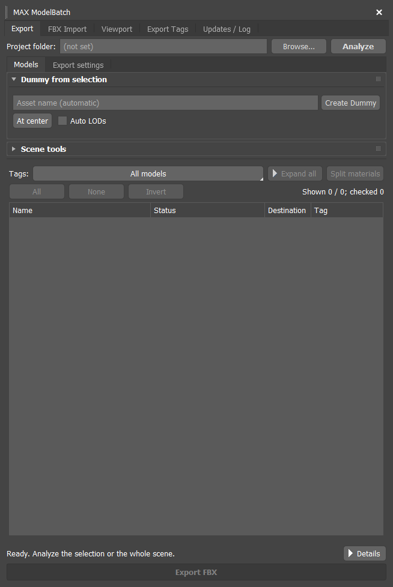
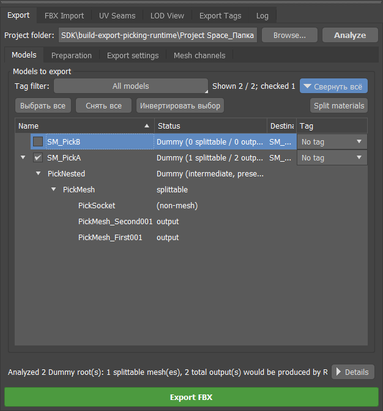
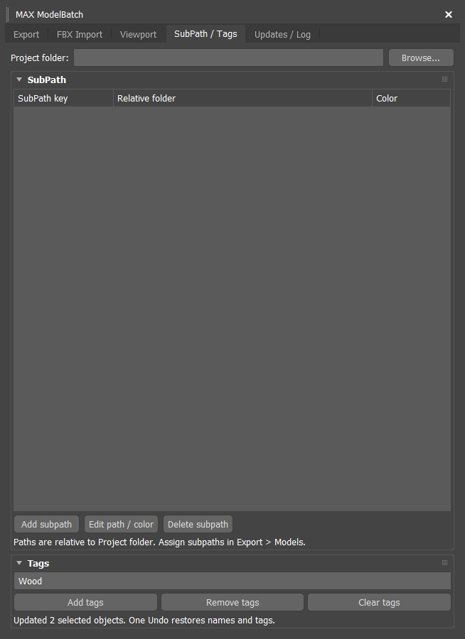
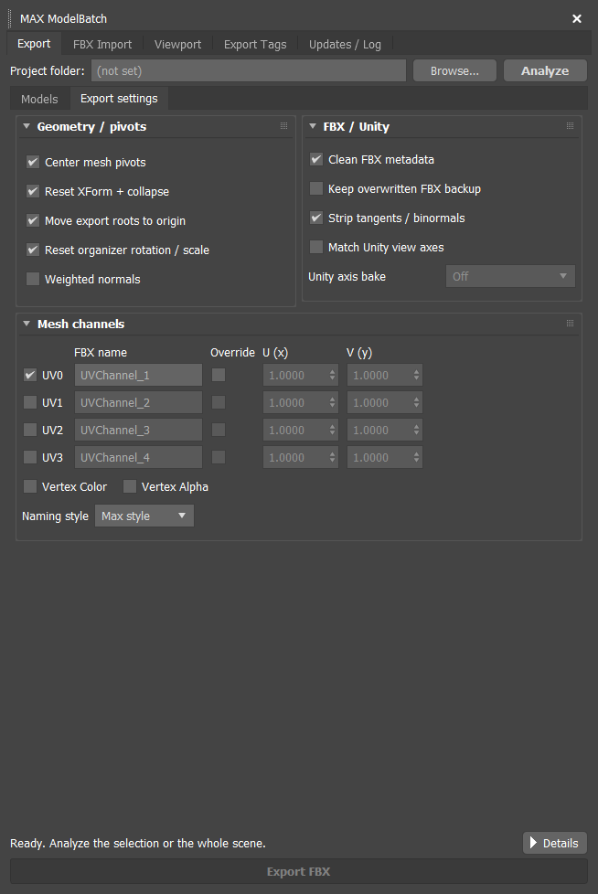
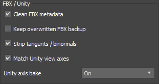
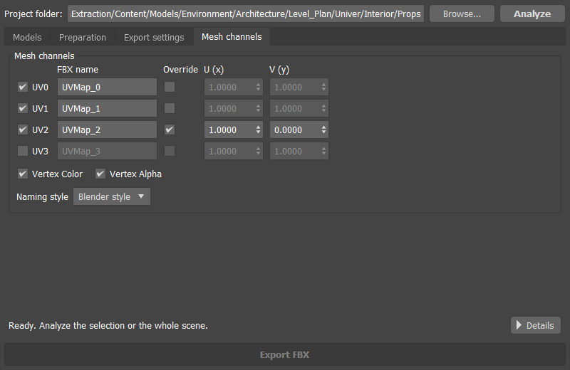
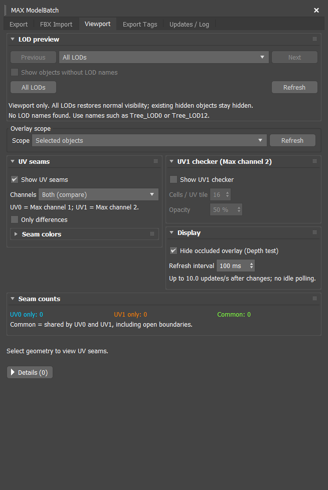
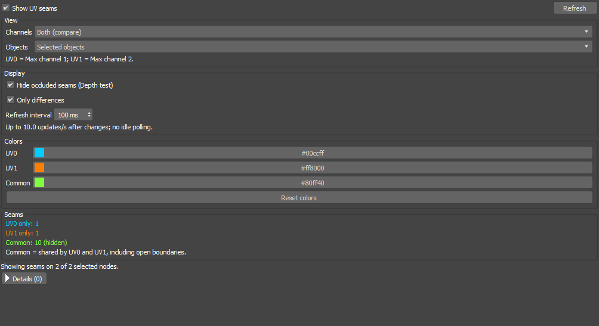
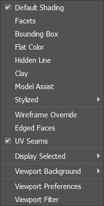
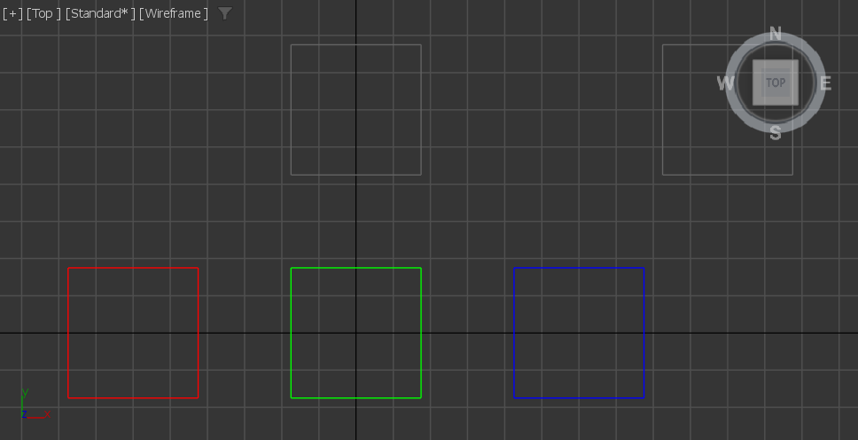

# MAX ModelBatch: illustrated user guide

**Version 1.3.8 · 3ds Max 2022-2027 · FBX + optional GLB · examples from Max 2024**

Batch-import, prepare and export models with a dockable Max panel: create export Dummies, write one FBX per asset, import files in batches, compare UV seams, preview LODs and route models into project folders using export subpaths.

Version 1.3.8 separates export SubPath routes from user name Tags and remembers the selected workflow page after restarting Max. Export and viewport settings retain the compact columns from 1.3.5 and stack in narrow docks. Seam counters share a row. Native Max headers and independent rollout state are retained; active viewers stop before host shutdown. Export settings and Viewport captures below are from 1.3.5 in Max 2024; their layout is retained in 1.3.8. The Models capture is from 1.3.4; other workflow captures are from 1.2.0 and may show earlier labels. Dummy placement at the LOD0 pivot, dock restoration, saved options and scene metadata are retained. Names, paths and checked options in screenshots are examples.

## Contents

- [1. Install and open](#install)
- [2. Your first export](#quickstart)
- [3. Create Dummies and prepare the scene](#preparation)
- [4. Work with the export table](#models)
- [5. SubPath, name tags and project folders](#tags)
- [6. Export settings](#settings)
- [7. Scale and Unity directions](#unity)
- [8. UV channels and vertex colors](#channels)
- [9. Display UV seams](#seams)
- [10. Preview LODs and organize layers](#lod)
- [11. Batch-import FBX files](#import)
- [12. Update and roll back](#updates)
- [13. Optional Mesh Align](#meshalign)
- [14. Optional GLB / meshopt](#glb)
- [15. Saved settings and troubleshooting](#help)

<a id="install"></a>
## 1. Install and open

1. Open the [1.3.8 release](https://github.com/SashaRX/MaxModelBatch-Releases/releases/tag/v1.3.8). Download the archive **for your exact Max year**. For Max 2024, [download the standard build](https://github.com/SashaRX/MaxModelBatch-Releases/releases/download/v1.3.8/MaxModelBatch_v1.3.8_3dsMax2024.zip).
2. Close Max. Extract the archive into a permanent folder such as `C:\Tools\MaxModelBatch\2024`. The plugin file is `MaxModelBatch.dlu`. Historical releases through 1.2.0 use `TS_UnityExport.dlu`.
3. In Max, open **Customize → Configure System Paths → 3rd-Party Plug-Ins → Add**. Add the folder containing the `.dlu`, then restart Max.
4. Open **Scripting → MAX ModelBatch** on **Max 2022-2024**, or **MAX ModelBatch → MAX ModelBatch** on **Max 2025-2027**. The legacy menu fallback on older hosts is also **MAX ModelBatch**. In the published **1.2.0** build, the command is still **Unity FBX Exporter**, under **Scripting** or **Unity Tools**.

For the first upgrade after the repository rename, close Max and manually replace the installation. Remove `TS_UnityExport.dlu` from all scanned plugin folders before installing `MaxModelBatch.dlu`, and keep one copy for each host. Existing scene subpaths and settings are retained.

Choose **Standard**, **Mesh Align**, **GLB** or **Mesh Align + GLB** on [Downloads](/downloads/#modelbatch). Standard includes the FBX, UV, LOD, import and subpath workflows. Mesh Align is experimental. GLB builds also require their matching separate Tools ZIP; see [GLB setup](#glb). Never mix Max years or plugin/worker variants. Max supplies Qt: do not install extra Qt DLLs. Public manual ZIP downloads need no GitHub account.

Dock the panel wherever it suits your workspace. The **Export** tab keeps **Project folder** and **Analyze** at the top and **Export FBX** at the bottom. Two workflow pages fill the middle: **Models** (Dummy creation, Scene tools and the list) and **Export settings** (Geometry / pivots, FBX / Unity and Mesh channels). Click a section header to collapse or expand it; this does not change its enabled tools. The saved dock tab reopens after restart; explicitly closing the panel keeps it closed.



*Models: Dummy creation, collapsible Scene tools and the export list. Run Analyze to fill the list.*

<a id="quickstart"></a>
## 2. Your first export

Place one asset's render meshes and collision meshes under one Dummy. If you already have that hierarchy, start with Analyze.

These steps match the public **1.3.8** downloads and the updated PDF. Models, Export settings and Viewport show the current layout; other workflow captures may have earlier labels.

1. Select the meshes of one asset in Max. Open **Export → Models**.
2. Enter an informative **Asset name**, such as `TrashCan`. Toggle **At center / At bottom / At LOD0 pivot**, optionally enable **Auto LODs**, and click **Create Dummy** above the model list.
3. Set **Project folder**, the common base for all relative subpath routes.
4. Click **Analyze**. With objects selected, the plugin collects their Dummy roots. With no selection, it searches Dummies throughout the scene.
5. In **Models**, check names, **Destination** and root checkboxes. Assign a subpath in the last column if needed.
6. Review **Export settings**, including its **Mesh channels** section, then click **Export FBX**.
7. Read the operation status at the bottom. Open **Details** or **Updates / Log → Log** for errors.

<a id="compact-ui"></a>
### Compact Dummy controls in 1.3.8

**Asset name**, **At center / At bottom / At LOD0 pivot**, **Auto LODs** and **Create Dummy** are directly above the Models list. Scene utilities are under **Models → Scene tools**. Naming, geometry placement and single-Undo behavior are retained. In older 1.2.1 builds, creation was under **Export → Preparation → Create Dummy from Selection**.

Each checked root that is visible through the current subpath filter produces a separate file named after its Dummy, for example `SM_TrashCan.fbx`. Its hierarchy, including `_COL` meshes, goes into that file.

Example hierarchy:

```text
SM_TrashCan                 ← export root and FBX filename
├── TrashCan_LOD0            ← most detailed alternative
├── TrashCan_LOD1
├── TrashCan_LOD2
└── TrashCan_COL             ← collision mesh
```

Do not assign a different LOD number to every part of a multipart model. Use polygon-count LOD naming when the selected objects or groups are alternative detail levels of the same asset.

<a id="preparation"></a>
## 3. Create Dummies and prepare the scene


*Historical 1.2.0 capture: Dummy creation was in Preparation. In 1.3.8 it is above the Models list; scene utilities are in Models → Scene tools. Organize export layers works on the whole scene.*

**At center / At bottom / At LOD0 pivot** determines the root's location:

| Mode | Position |
|---|---|
| At center | Center of the combined world-space geometry bounds |
| At bottom | The same X/Y center at the lowest geometry Z |
| At LOD0 pivot | World pivot position of the unique named LOD0 object/group; with Auto LODs, the highest-poly alternative |

Without Auto LODs, missing or ambiguous LOD0 stops without changing the scene. Collision branches are excluded; a named LOD0 group owns its descendant pivots. Only position is copied: geometry stays in place, with identity root rotation and scale.

“Floor” means the bottom of the selected model, not world `Z = 0`. Creating the root preserves the geometry's world placement.

Enter a shared base name in **Asset name** or leave it blank to let the plugin choose an informative selected name. Automatic naming uses heuristics. If it finds no suitable candidate, it asks for a name. An explicit name is useful when a scene still contains names such as `Plane003`, numbers or temporary placeholders.

The root gets `SM_` without trailing `_COL` or `_LOD#`: `SM_TrashCan`. Child names lose the `SM_` prefix. **Auto LODs** gives every LOD the same base name: more polygons means a lower LOD number; equal counts use selection order. A selected group's count includes its render descendants. Collision branches are excluded and retain `_COL`. Automatic ranking supports up to ten LOD alternatives.

One **Ctrl+Z** undoes Dummy creation, naming and parenting.

| Scene tool | What it does |
|---|---|
| Normalize Dummies | Sets every Dummy helper's box size to 1×1×1 |
| Hide _COL | Hides collision branches by the `_COL` suffix; click again to show them |
| Rebuild SG from Normals | Rebuilds smoothing groups on selected Editable Poly/Mesh objects from their existing normals |
| Rebuild SG from UV | Rebuilds smoothing groups from UV seams in the base object's Max channel 1 |
| Organize export layers | Routes the whole scene into shared LOD0, LOD1, … and COL layers |

For **Rebuild SG from UV**, UV data must be in the base object. If it exists only in a UVW Mapping or Unwrap modifier, prepare/collapse that stack first. This tool changes smoothing; UV seam display only inspects the model.

<a id="models"></a>
## 4. Work with the export table



*An expanded hierarchy shows Dummies, child objects and anticipated material-split outputs.*

- A **root checkbox** includes the asset in export. Row selection is a separate action.
- Click **Name**, **Status** or **Destination** to select that object in Max. A Dummy selects itself and all descendants, including collapsed branches. A mesh row selects the mesh itself.
- Use **Ctrl/Shift** for multiple rows. The **SubPath** column opens the subpath dropdown without changing scene selection.
- Analyze starts with branches collapsed. **Развернуть всё / Свернуть всё** means **Expand all / Collapse all** and toggles all hierarchy levels shown by the current filter.
- **All / None / Invert** change export checkboxes only for roots visible through the subpath filter. Filtered-out models keep their checkboxes.
- Drag a column divider to resize it, or double-click it to fit the contents. Click a heading to sort; click again to reverse the order. Children remain under their root.

**Split materials** splits render meshes with Multi/Sub materials into meshes per material. Analyze previews the expected outputs. The button processes **all models shown by the filter, regardless of root checkboxes**. An output preview is not yet a scene object, so it cannot be selected in the viewport before the split.

Analyze populates the table; it does not export or run Split. Historical screenshots can show longer or Russian labels; 1.3.8 uses **All / None / Invert** for export checkboxes.

<a id="tags"></a>
## 5. SubPath, name tags and project folders

**SubPath** controls where a Dummy is exported. **Tags** are words in object names. Both tools share the **SubPath / Tags** page, but have independent assignments.



*SubPath / Tags in a pre-release Max 2024 validation build: project routes above, name-tag actions below. The layout is retained in 1.3.8.*

### Choose an export SubPath

The old export Tag is now called **SubPath**. Existing saved keys, folders, colors and assignments continue to work. Each Dummy has one route for its whole hierarchy.

1. Set a common **Project folder**, for example `D:\Game\Assets`.
2. Open **SubPath / Tags → SubPath → Add subpath** and enter a key, such as `props`.
3. Use **Browse...** beside **Relative folder** to choose a folder inside the project. Choosing `D:\Game\Assets\Models\Props` stores `Models/Props`.
4. Choose a color and confirm. Assign the route in the **SubPath** column of **Export → Models**. To assign several roots, select their rows and use right-click → **Assign export subpath to selected roots**.

```text
Project folder     D:\Game\Assets
SubPath            props
Relative folder    Models/Props
Dummy              SM_TrashCan
Output             D:\Game\Assets\Models\Props\SM_TrashCan.fbx
```

Export creates missing relative folders. Folders outside the project are rejected. **No subpath** exports directly into Project folder. If the root already points at `Assets`, do not repeat `Assets` in the relative route.

**Edit path / color** keeps the key while changing its route and color. The color tints names in the export table and the Dummy in the viewport. Deleting a definition keeps its assignments visible as missing; restore or reassign them before exporting. Duplicate destination filenames block the batch before writing.

Open **SubPath filter** to show several routes together, optionally including **No subpath**. **All models** shows every analyzed root; clearing every choice shows none. Save the `.max` scene to retain the filter and export checkboxes.

Dummy User Defined Properties and exported FBX carry the route, relative folder and color. Clones retain them. **Restore export subpaths and relative folders from FBX** rebuilds missing definitions during FBX Import; conflicting routes get separate keys. Set the receiving project's absolute folder separately.

<a id="name-tags"></a>
### Add user tags to object names

Select the exact objects in Max, enter tags such as `Wood, Wet` or `PM_Concrete`, then choose **Add tags**. For example:

```text
Chair_LOD0       → Chair_Wood_Wet_LOD0
Chair_COL        → Chair_Wood_Wet_COL
Chair_LOD2_COL   → Chair_Wood_Wet_LOD2_COL
```

**Remove tags** removes the entered managed tags; **Clear tags** removes all tags added by this tool. Repeating Add keeps a tag only once. The command edits only the selected nodes, without expanding selection to their children or export roots. A conflicting target name rejects the whole batch.

Tags can mark physical-material types or other project conventions. They change names, not assigned materials. Use Latin letters, digits and single underscores; separate multiple tags with commas, spaces or semicolons. `COL`, `LOD` and numbered LOD tokens are reserved structural suffixes.

One **Undo/Redo** restores the names and tag metadata together. Save the scene to retain them. Clear preserves ordinary authored name text; manually written words are not guessed to be managed tags. Auto LOD keeps each object's managed tags before its new LOD suffix and excludes them when inferring the Dummy's base name.

<a id="settings"></a>
## 6. Export settings



*Export settings: Geometry / pivots on the left, FBX / Unity on the right, Mesh channels below at full width. Narrow docks stack the columns; each native section collapses independently.*

| Option | Behavior |
|---|---|
| Center mesh pivots | Centers render-mesh pivots on geometry. `_COL` pivots follow the export Dummy regardless of this checkbox |
| Reset XForm + collapse | Bakes mesh rotation/scale and collapses the stack. Turn off to retain authored mesh Transforms |
| Move export roots to origin | Exports roots at the origin, then restores their scene positions |
| Reset organizer rotation / scale | Cleans organizer Dummy rotation/scale for export. Turn off to retain authored values |
| Weighted normals | Temporarily applies Weighted Normals to render meshes; skips `_COL` |
| Clean FBX metadata | Removes unnecessary FBX data while retaining scene identity and routing data |
| Keep overwritten FBX backup | Keeps an `.fbx.bak` when overwriting an existing FBX |
| Strip tangents / binormals | Lets Unity recalculate tangents; enabled by default |
| Match Unity view axes | Aligns exported model directions with Unity; see below |

Pivot/Reset XForm preparation can persist in the scene with Undo. Temporary export changes to root positions and collision snapshots are restored. The exporter handles static model hierarchies, not animated rigs. Remember that **collapse** changes the source object's modifier stack.

<a id="unity"></a>
## 7. Scale and Unity directions

The project convention is **1 Max System Unit = 1 meter**. Exported FBX files use meters. Older scenes with other System Units are converted on export without changing the scene's units. **Display Units** control number formatting, not physical size.

To check scale, export a 1-meter object and compare its imported bounds with a 1-unit Unity cube. Transform Scale alone does not prove that the model has the correct physical size.



*Match Unity view axes is enabled; this example uses Unity axis bake: On.*

1. Enable **Export → Export settings → Match Unity view axes**.
2. Set **Unity axis bake: Off/On** to match **Bake Axis Conversion** in that FBX's Unity Model Import Settings.
3. Re-export and reimport after changing this choice.

| Max view/direction | Max axis | Unity direction |
|---|---|---|
| Front | -Y | +Z |
| Back | +Y | -Z |
| Top | +Z | +Y |
| Bottom | -Z | -Y |
| Right | +X | +X |
| Left | -X | -X |

Direction matching defaults to off. It affects the exported model and Transform hierarchy, not Max's viewport or gizmo. It is not a live connection to Unity. For verification, use an asymmetric model labeled Front/Top/Right. A clean source root with normalization enabled should have zero rotation and Scale `(1,1,1)`; authored transforms may remain when their Reset options are off.

<a id="channels"></a>
## 8. UV channels and vertex colors

Open **Export → Export settings → Mesh channels** and expand the section.



*Mesh channels: include channels, choose layer names and optional constant values. This capture has a saved UV2 Override example.*

- **UV0-UV3** checkboxes choose the UV sets written to FBX. **UV0 = Max channel 1**, UV1 = channel 2, and so on.
- **FBX name** sets the layer name. An empty field uses the selected **Naming style** default.
- **Override** replaces the enabled channel's data with the constant **U/V** values for every polygon corner. This can carry a shader parameter in an extra UV set.
- Without Override, the constant only fills a channel with no existing data.
- **Vertex Color / Vertex Alpha** enable the corresponding render-mesh data. `_COL` meshes omit these extra channels.

With fresh preferences, UV0 is on; UV1-UV3, Vertex Color and Vertex Alpha are off. Saved settings can differ. Enable UV1 when the second UV set must be exported.

<a id="seams"></a>
## 9. Display UV seams



*Viewport keeps LOD preview and scope full width. UV seams is on the left; UV1 checker and Display are stacked on the right. Seam counters share a row. Narrow docks return to one column without changing feature settings.*



*UV Seams: channels, object scope, depth test, refresh interval and colors. The capture uses Both with Only differences enabled.*

1. Open **Viewport → UV seams** and enable **Show UV seams**.
2. Choose **UV0 (Max channel 1)**, **UV1 (Max channel 2)** or **Both (compare)** under **Channels**.
3. Choose **Selected objects** or **All visible objects** under **Objects**.
4. Adjust depth, difference display and colors.

| Default color | Both (compare) | Single-channel mode |
|---|---|---|
| Cyan | Seam unique to UV0 | All UV0 seams |
| Orange | Seam unique to UV1 | All UV1 seams |
| Green | Seam shared by UV0 and UV1 | Not used separately |

**Only differences** hides shared seams only in Both mode. Open boundaries also count as seams. Click the **UV0**, **UV1** or **Common** swatch to change its color; **Reset colors** restores the palette.

**Hide occluded seams (Depth test)** hides lines behind shaded surfaces. Turn it off to see seams through the model.


*Depth test on: the front surface hides the left part of the orange diagonal.*


*Depth test off: the full diagonal is drawn. Switch between these real captures in the web guide.*

**Refresh interval** is the minimum interval between scheduled updates after changes: **16-2000 ms**, default **100 ms**. Idle scenes are not continuously polled. Shorter intervals show edits sooner; longer intervals reduce refresh work. For heavier scenes, try 200-500 ms and Selected objects. **Refresh** requests a fresh snapshot; **Details** explains skipped nodes or UV issues.

The overlay reads the evaluated modifier stack, including Editable Poly edits and Unwrap UVW. It does not collapse or modify the mesh. Once enabled, it continues working when you switch tabs or close the panel. Single-channel viewing does not require the other UV set to exist.



*You can also toggle UV Seams in the viewport shading menu, directly below Edged Faces. It shares the Show UV seams state.*

<a id="lod"></a>
## 10. Preview LODs and organize layers

### Preview a detail level

In **Viewport → LOD preview**, choose **LOD0**, **LOD1**, … from the detected levels. **Previous / Next** skip missing levels. **All LODs** restores normal scene visibility.

Levels come from **object or group names**, such as `Tree_LOD0`, `Tree_LOD1` or `Tree_LOD12`. Children inherit their closest named ancestor's LOD; their own explicit LOD name takes priority. Preview supports numbers above 9, although automatic Dummy naming is limited to LOD0-LOD9.



*All LODs: red LOD0, green LOD1 and blue LOD2 along the bottom; two objects without LOD names above.*


*LOD1 selected, Show objects without LOD names off. The web guide also lets you inspect LOD0 and LOD2.*

**Show objects without LOD names** keeps unrelated geometry visible. Preview continues with the panel closed and preserves existing object/layer Hide states. Scene replacement resets it to All LODs. UV seams follow the previewed level.

### Organize shared layers

Click **Export → Models → Scene tools → Organize export layers**. It works on the **whole scene**, independently of selection, export checkboxes and subpath filters:

- creates missing shared `LOD0`, `LOD1`, … and `COL` layers;
- assigns objects using their names and inherited LOD markers;
- puts `_COL` branches in `COL`, including inside LOD groups;
- keeps existing layer settings; one **Ctrl+Z** undoes the batch.

LOD preview temporarily filters the viewport. Layer organization changes scene-layer membership. Use Models to choose exports: LOD preview itself does not choose which nodes go into an exported file.

<a id="import"></a>
## 11. Batch-import FBX files


*FBX Import: folder, file table, options and Import Selected. Names and file sizes are test examples.*

1. Open **FBX Import → Folder → Browse...**.
2. Select one or more files with **Ctrl/Shift**. **Select All** selects the list; **Clear Selection** clears it.
3. Enable **Show FBX options for the first file** if needed. Max's native import dialog opens for the first available file so you can configure the batch.
4. Keep **Restore export subpaths and relative folders from FBX** enabled to recover this plugin's routing metadata.
5. Click **Import Selected**. All selected files are imported into the **current scene**. Read Status and the per-file report.

**Refresh** reloads the directory. **Stop after current file** ends the batch after the ongoing file finishes. Sort on headings and resize columns manually. The batch uses Max's FBX importer settings; it does not create a separate `.max` scene per file.

<a id="updates"></a>
## 12. Update and roll back

The **Updates / Log** page contains update actions and a collapsible **Log** section with Copy, Clear and Auto-scroll.

**Public manual update:** download the 1.3.8 ZIP for your exact Max year and feature variant from [Downloads](/downloads/#modelbatch). Save your scene, close Max, replace the installed `.dlu` and restart. For GLB builds, also install the matching tools package. No GitHub account is needed for these public downloads.

The **in-plugin updater still uses the private development repository**. Its actions require `gh auth login` with repository access and a writable plugin folder. Publishing public ZIPs does not change that requirement.


*Historical Updates capture from an earlier test build. 1.3.8 uses the compact labels below; versions and paths in this image are examples.*

1. Open **Updates / Log → Check now**.
2. If an update is available, click **Install update**. The package is downloaded and checked against the exact Max year and build variant.
3. When ready, save your scene and close Max. Installation waits for that process to exit.
4. Restart Max after installation finishes and check **Installed**, including the feature variant and **+ GLB** when enabled.

**Check at startup** enables startup checks. **Download and install after closing Max** also enables the startup check and automatically prepares compatible updates. Both options default to off.

**Roll back** prepares restoration of the previous binary after Max closes. **Retry install** retries a prepared installation if another process prevented replacement. The previous binary is retained for rollback.

Status text distinguishes information/progress, success/current, warnings/available updates and errors with different colors and explicit messages. **Plugin file** is read-only; its tooltip shows the complete loaded path. **Website / guide** opens this public manual.

When migrating from `TS_UnityExport.dlu`, remove old copies from scanned folders and install the renamed plugin manually once. Keep one plugin copy per host. There is no hot reload.

<a id="meshalign"></a>
## 13. Optional Mesh Align

**Mesh Align** appears only in `_MeshAlign.zip` and `_MeshAlign_GLB.zip` builds. It aligns planes and border vertices of neighboring modular Editable Poly meshes. It is a geometry utility rather than a required FBX-export stage.

1. Select modular meshes and click **Analyze selection** to detect planar regions and shared plane clusters.
2. Inspect the results. Double-click a region or cluster to highlight its faces.
3. **Project all clusters / Project selected clusters** move vertices onto the agreed cluster planes.
4. **Weld borders (all clusters) / Weld borders (selected clusters)** align border-vertex positions while respecting those planes.

Analyze and highlighting are read-only. Project/Weld move existing vertices with Undo; they do not merge objects or add/remove polygons. Modification requires a base Editable Poly without a modifier stack. Distance parameters are relative to the selected bounds. UV-aware welding is not implemented yet.

<a id="glb"></a>
## 14. Optional GLB / meshopt

The **GLB / meshopt** tab is included only in `_GLB.zip` and `_MeshAlign_GLB.zip` plugin builds. Standard and Mesh Align builds without GLB keep the FBX workflows.

1. Download the plugin and its matching `_GLB_Tools.zip` or `_MeshAlign_GLB_Tools.zip` for the **same 1.3.8 version, Max year and feature variant** from [Downloads](/downloads/#modelbatch).
2. Extract the tools into a permanent writable folder. Keep the manifests and licenses. In GLB settings select its `gltfpack.exe` and `MaxModelBatchGlbWorker.exe`; the worker must match the plugin build. Replace the tools together with every GLB plugin update.
3. Use **Scene export** to analyze Dummy roots, apply the shared subpaths/filter, check models and export current evaluated static geometry, including unsaved edits. GLB capture does not run FBX pivot preparation or collapse the scene stack.
4. Use **Pack existing GLB** for existing files. Check the selected compatibility profile and validation report before using optimized output in your target application.

GLB uses metres and right-handed Y-up / -Z forward. Unsupported skin/morph, animation and unsupported material/map features produce a report. Meshopt compression needs a compatible decoder. Optional meshlet bundles contain an ordinary GLB plus a versioned sidecar and manifest; they need consumer support and do not automatically enable GPU rendering or game behavior. Keep the default compatibility profile unless the target loader supports the chosen options.

The updater replaces the plugin only, not this separate tools installation. Production game/GPU meshlet consumption remains pending.

<a id="help"></a>
## 15. Saved settings and troubleshooting

### What is saved

| Data | Storage |
|---|---|
| Project folder, subpath definitions, chosen filter, export checkboxes | In the `.max` scene after saving |
| Model subpath, relative path and color | Dummy User Defined Properties and exported FBX |
| Table widths/sorting, export preferences, UV colors/interval, Updates options | Per-user plugin settings |
| SubPath definitions for new scenes in the same project | Also remembered per project |

The panel also remembers the selected workflow page by a stable identifier. An unavailable optional page falls back to Export; the dock and rollup state stay independent.

### Common questions

| Symptom | Check |
|---|---|
| Analyze misses models | Clear Max selection to analyze the whole scene; check Dummy roots and SubPath filter |
| Export FBX is disabled | Set Project folder and ensure visible roots have export checkboxes; check for an empty filter |
| No UV seams appear | Check Show UV seams, channel, Selected/All visible scope, current LOD, Hide states and Details |
| Shared seams disappeared | Disable Only differences in Both mode |
| UV edits appear late | Lower Refresh interval; restrict heavier scenes to Selected objects |
| Dummy color looks wrong | Check subpath/color, selected/frozen state and the loaded build; restart after manual binary replacement |
| A missing subpath blocks export | Restore its definition or assign an existing subpath/No subpath |
| Two roots target one file | Change a root name or subpath folder; duplicate output paths block the batch |
| Unity size or Front is wrong | Check System Units, actual bounds and the matching axis-bake setting |
| The old UI remains after replacement | Close Max, keep only one registered `.dlu` for that year, then restart |

**Details** shows the complete operation report; **Log** helps explain failures. Invalid filenames, zero scale and unsupported Transforms can block export until the scene is corrected.

For a new Max 2024 build, try: create a Dummy → Analyze → assign a subpath → export one FBX → import it → inspect UV Seams → preview LODs. Save and reopen the `.max` scene to verify filter, checkbox and subpath persistence.

Technical references in the plugin repository, subject to repository access: [UV seams](https://github.com/SashaRX/MaxModelBatch/blob/main/docs/UV_SEAMS.md), [export subpaths](https://github.com/SashaRX/MaxModelBatch/blob/main/docs/EXPORT_TAGS.md), [Dummy creation](https://github.com/SashaRX/MaxModelBatch/blob/main/docs/DUMMY_CREATION.md), [Unity axes](https://github.com/SashaRX/MaxModelBatch/blob/main/docs/UNITY_AXES.md), [units](https://github.com/SashaRX/MaxModelBatch/blob/main/docs/EXPORT_UNITS.md), [updates](https://github.com/SashaRX/MaxModelBatch/blob/main/docs/UPDATES.md), [Mesh Align](https://github.com/SashaRX/MaxModelBatch/blob/main/docs/MESHALIGN.md).
