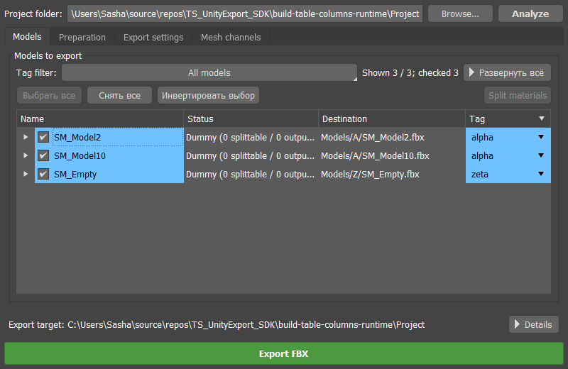
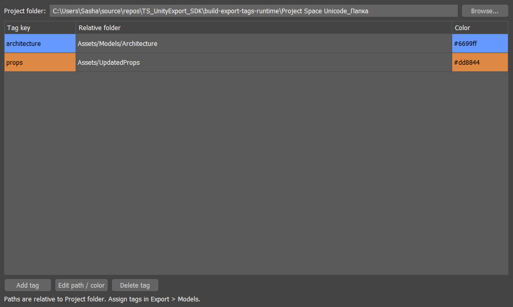

# MAX ModelBatch: руководство с иллюстрациями

**Версия 1.2.1 · 3ds Max 2022-2027 · работа с FBX · примеры из Max 2024**

Плагин помогает импортировать, готовить и экспортировать модели через панель Max: создавать корневые Dummy, сохранять отдельный FBX для каждой модели, импортировать файлы пачкой, сравнивать UV-швы, просматривать LOD и распределять модели по папкам проекта с помощью тегов. FBX можно использовать в Unity и других инструментах; согласование осей Unity включается отдельно.

MAX ModelBatch - новое имя TS_UnityExport. Версия 1.2.1 использует новое название, репозиторий и имя файла плагина, сохраняя настройки и данные сцен. Иллюстрации сняты в настоящем Max 2024 на тестовых сценах версии 1.2.0, поэтому на них остаются прежние названия интерфейса. Переименование, старые теги и пути сцен, а также настоящий экспорт FBX проверены отдельно в Max 2024. Все двенадцать вариантов SDK-сборки проходят регрессионные тесты; проверка в остальных версиях самого Max ещё требуется. Имена объектов, пути, галочки и номера версий на снимках служат примерами, а не набором настроек по умолчанию.

Названия кнопок и вкладок ниже оставлены на английском, как в интерфейсе плагина, чтобы их было проще найти.

## Содержание

- [1. Установка и открытие](#install)
- [2. Первый экспорт](#quickstart)
- [3. Dummy, имена и подготовка](#preparation)
- [4. Таблица экспортируемых моделей](#models)
- [5. Теги, цвета и папки проекта](#tags)
- [6. Настройки экспорта](#settings)
- [7. Масштаб и направления Unity](#unity)
- [8. UV-каналы и цвета вершин](#channels)
- [9. Отображение UV-швов](#seams)
- [10. Просмотр LOD и общие слои](#lod)
- [11. Пакетный импорт FBX](#import)
- [12. Обновление и откат](#updates)
- [13. Mesh Align: дополнительная сборка](#meshalign)
- [14. Сохранение настроек и частые вопросы](#help)

<a id="install"></a>
## 1. Установка и открытие

1. Открой [релиз 1.2.1](https://github.com/SashaRX/MaxModelBatch-Releases/releases/tag/v1.2.1). Выбери архив **для своего года Max**. Для Max 2024: [скачать стандартную сборку](https://github.com/SashaRX/MaxModelBatch-Releases/releases/download/v1.2.1/MaxModelBatch_v1.2.1_3dsMax2024.zip).
2. Закрой Max. Распакуй архив в постоянную папку, например `C:\Tools\MaxModelBatch\2024`. Основной файл - `MaxModelBatch.dlu`. В исторических релизах до 1.2.0 включительно он назывался `TS_UnityExport.dlu`.
3. В Max открой **Customize → Configure System Paths → 3rd-Party Plug-Ins → Add**. Добавь папку с `.dlu` и перезапусти Max.
4. В новой сборке открой **Scripting → MAX ModelBatch** на **Max 2022-2024**, либо **MAX ModelBatch → MAX ModelBatch** на **Max 2025-2027**. Резервное меню на старых версиях Max также называется **MAX ModelBatch**. В опубликованной сборке **1.2.0** команда ещё называется **Unity FBX Exporter** и находится в **Scripting** или **Unity Tools**.

При первом обновлении после переименования репозитория закрой Max и вручную замени установку. Удали `TS_UnityExport.dlu` из всех папок, которые Max сканирует при поиске плагинов, перед установкой `MaxModelBatch.dlu`. Для каждого года Max должна остаться одна подходящая копия. Настройки и теги существующих сцен сохраняются.

Стандартный архив содержит все основные функции этого руководства, кроме экспериментального Mesh Align. Для него нужен архив с суффиксом `_MeshAlign.zip`. Qt поставляется вместе с Max: дополнительные Qt DLL в папку плагина копировать не нужно. ZIP доступны публично в MaxModelBatch-Releases, без входа в GitHub.

Панель можно закрепить в удобной области окна Max. На вкладке **Export** папка проекта и **Analyze** находятся сверху, **Export FBX** - снизу. Между ними четыре страницы: **Models**, **Preparation**, **Export settings**, **Mesh channels**.



*Models: папка проекта, фильтр, список корней, теги и кнопка экспорта. На снимке показаны три тестовых корня.*

<a id="quickstart"></a>
## 2. Первый экспорт

Для одного ассета собери визуальные меши и коллизии под одним Dummy. Если такая иерархия уже есть, переходи сразу к Analyze.

Эти шаги описывают компактный интерфейс. В ранних версиях открой **Export → Preparation** и используй **Create Dummy from Selection**. PDF и скриншоты показывают этот прежний интерфейс.

1. Выдели меши одной модели в Max. Открой **Export → Models**.
2. Введи понятную основу в **Asset name**, например `TrashCan`. Переключи **At center / At bottom** и нажми **Create Dummy**.
3. Укажи **Project folder** - общую папку, относительно которой будут рассчитываться пути тегов.
4. Нажми **Analyze**. Если выделены объекты, анализируются их корни Dummy. Если ничего не выделено, плагин ищет Dummy по всей сцене.
5. На странице **Models** проверь имена, **Destination** и галочки корней. При необходимости назначь тег в последнем столбце.
6. Проверь **Export settings** и **Mesh channels**. Нажми **Export FBX**.
7. Посмотри результат операции снизу и открой **Details** или **Log**, если есть ошибки.

Каждый отмеченный корень, видимый через текущий фильтр тегов, экспортируется в отдельный файл с именем Dummy: например `SM_TrashCan.fbx`. В файл входит его иерархия, включая `_COL`.

Пример структуры одного ассета:

```text
SM_TrashCan                 ← экспортный корень, имя файла
├── TrashCan_LOD0            ← самый подробный вариант
├── TrashCan_LOD1
├── TrashCan_LOD2
└── TrashCan_COL             ← коллизия
```

LOD не нужно включать для каждой детали составной модели. Используй LOD-ранжирование, когда выбранные объекты или группы представляют альтернативные уровни детализации одного ассета.

<a id="preparation"></a>
## 3. Dummy, имена и подготовка


*Снимок прежнего интерфейса. В компактном интерфейсе создание Dummy находится над списком Models, инструменты сцены остаются в Preparation. Organize LOD / COL layers работает со всей сценой.*

**At center / At bottom** переключает точку корня:

| Режим | Где окажется Dummy |
|---|---|
| At center | В центре общего bounding box геометрии выбранной иерархии |
| At bottom | В том же центре по X/Y, но на нижней границе геометрии по Z |

«У пола» означает низ выбранной модели, а не мировой `Z = 0`. Положение видимой геометрии при создании корня сохраняется.

В **Asset name** можно явно задать общую основу имени. Если оставить поле пустым, плагин ищет информативное имя среди выделенных объектов. Автоматический выбор использует эвристики; когда подходящей основы нет, появится запрос имени. Явное имя удобнее, если в сцене остались `Plane003`, числовые или временные названия.

Корень получает `SM_`, но не постфиксы `_COL` и `_LOD#`: `SM_TrashCan`. У дочерних объектов `SM_` убирается. **Auto LODs** присваивает всем LOD общую основу: больше полигонов - меньший номер; при равенстве учитывается порядок выделения. Выбранная группа считается по сумме её render-мешей. Коллизии исключаются из ранжирования и сохраняют `_COL`. Автоматическое ранжирование рассчитано максимум на десять LOD-вариантов.

Создание Dummy, переименование и переподчинение отменяются одним **Ctrl+Z**.

Инструменты сцены:

| Кнопка | Действие |
|---|---|
| Normalize Dummies | Приводит размеры бокса всех Dummy к 1×1×1 |
| Hide _COL | Скрывает коллизии по суффиксу `_COL`; повторное нажатие показывает их |
| Rebuild SG from Normals | Восстанавливает smoothing groups выделенных Editable Poly/Mesh по готовым нормалям |
| Rebuild SG from UV | Восстанавливает smoothing groups выделенных Editable Poly/Mesh по UV-швам Max channel 1 базового объекта |
| Organize LOD / COL layers | Раскладывает объекты всей сцены по общим слоям LOD0, LOD1, … и COL |

Для **Rebuild SG from UV** UV должны быть в базовом объекте: если они находятся только в модификаторе Unwrap/UVW Mapping, сначала подготовь стек. Этот инструмент меняет сглаживание; он отличается от просмотра UV-швов, который сцену не меняет.

<a id="models"></a>
## 4. Таблица экспортируемых моделей


*В раскрытой иерархии видны Dummy, дочерние объекты и предполагаемые результаты разделения материалов.*

- **Галочка у корня** включает его в экспорт. Она отличается от обычного выделения строки.
- Клик по **Name**, **Status** или **Destination** выделяет соответствующий объект в Max. Dummy выделяется вместе со всеми потомками, даже когда ветка свёрнута. Клик по обычному мешу выбирает сам меш.
- **Ctrl/Shift** позволяют выделять несколько строк. Столбец **Tag** открывает выпадающий список назначения тега и не меняет выделение сцены.
- После **Analyze** ветки свёрнуты. **Развернуть всё / Свернуть всё** переключает все уровни показанных иерархий.
- **Выбрать все**, **Снять все**, **Инвертировать выбор** меняют экспортные галочки только у моделей, видимых через фильтр тегов. Скрытые фильтром модели сохраняют свои галочки.
- Потяни границу столбца, чтобы изменить ширину; двойной клик по границе подбирает её по содержимому. Клик по заголовку сортирует строки, повторный клик меняет порядок. Дочерние объекты остаются под своим корнем.

**Split materials** разделяет render-меши с Multi/Sub материалами на меши по материалам. Analyze заранее показывает предполагаемые результаты. Кнопка обрабатывает **все показанные фильтром модели, независимо от экспортных галочек**. Строка предполагаемого результата ещё не является объектом сцены, поэтому до разделения её нельзя выбрать во viewport.

Analyze заполняет список, но сам по себе не экспортирует и не выполняет Split.

<a id="tags"></a>
## 5. Теги, цвета и папки проекта

Тег связывает модель с относительной папкой. У одного Dummy один тег для всей его иерархии.



*Export Tags: ключ, относительная папка, цвет; снизу добавление, редактирование и удаление.*

1. Задай общую **Project folder**. Например, `D:\Game\Assets`.
2. Открой **Export Tags → Add tag**. Введи ключ, например `props`.
3. Для **Relative folder** нажми **Browse...** и выбери папку внутри проекта. При корне `D:\Game\Assets` и папке `D:\Game\Assets\Models\Props` сохранится `Models/Props`.
4. Выбери цвет и подтверди. Кнопка цвета сразу показывает выбранную подложку.
5. На **Export → Models** назначь тег через последний столбец. Для нескольких корней выдели строки и используй правый клик → **Assign export tag to selected roots**.

Пример итогового пути:

```text
Project folder     D:\Game\Assets
Tag                props
Relative folder    Models/Props
Dummy              SM_TrashCan
Result             D:\Game\Assets\Models\Props\SM_TrashCan.fbx
```

Относительный путь можно ввести вручную, даже если папки ещё нет: экспорт создаст её. Папка вне проекта не принимается. **No tag** отправляет FBX непосредственно в Project folder. Если в качестве корня выбран каталог `Assets`, не добавляй `Assets` повторно в относительный путь.

**Edit path / color** меняет маршрут и цвет, сохраняя ключ. Цвет используется как подложка имён в списке с контрастным текстом и как цвет Dummy во viewport. Вид выделенного или замороженного объекта может зависеть от правил отображения самого Max.

Удаление определения тега не стирает назначение у Dummy. Такой тег станет отсутствующим; экспорт нужно разблокировать переназначением или восстановлением определения. Два корня с одинаковым итоговым именем файла в одной папке блокируют пакет до записи.


*Фильтр: можно отметить несколько тегов и No tag. All models показывает все корни.*

Открой **Tag filter**, отметь нужные теги и закрой меню нажатием вне него или **Esc**. Несколько тегов объединяются: показываются модели с любым из выбранных тегов. Если снять абсолютно все пункты, список будет пустым. Выбранные теги фильтра и галочки экспорта сохраняются вместе со сценой после сохранения `.max`.

Назначение тега, относительный путь и цвет находятся в User Defined Properties Dummy. Копии сохраняют их; они также записываются в FBX. При импорте **Restore export tags and relative folders from FBX** восстанавливает определения. Конфликтующие маршруты получают отдельные теги. Абсолютный Project folder задаётся для текущего проекта отдельно.

<a id="settings"></a>
## 6. Настройки экспорта


*Export settings: слева подготовка геометрии и pivot, справа параметры FBX/Unity. Галочки на снимке - пример сохранённых настроек.*

| Опция | Когда нужна и что меняет |
|---|---|
| Center mesh pivots | Центрирует pivot render-мешей по геометрии. Pivot `_COL` привязывается к экспортному Dummy независимо от этой галочки |
| Reset XForm + collapse | Запекает rotation/scale мешей и схлопывает стек. Выключи, если нужно сохранить авторские Transform на мешах |
| Move export roots to origin | Экспортирует корни у начала координат; исходное положение восстанавливается после операции |
| Reset organizer rotation / scale | Убирает rotation/scale организационных Dummy при экспорте. Выключи для сохранения авторских трансформаций |
| Weighted normals | Временно применяет Weighted Normals к render-мешам; `_COL` пропускается |
| Clean FBX metadata | Очищает лишние данные FBX, сохраняя нужные для сцены и маршрутизации |
| Keep overwritten FBX backup | Сохраняет `.fbx.bak` при перезаписи существующего файла |
| Strip tangents / binormals | Оставляет пересчёт тангентов Unity; по умолчанию включено |
| Match Unity view axes | Согласует направления модели с Unity; подробнее ниже |

Подготовка pivot/Reset XForm может оставаться в сцене и иметь Undo. Экспортные временные изменения положения корней и коллизий восстанавливаются. Плагин экспортирует статические иерархии моделей, а не анимацию или риги. Для повторной работы со стеком учитывай, что **collapse** меняет исходный объект.

<a id="unity"></a>
## 7. Масштаб и направления Unity

Проектная договорённость: **1 System Unit в Max = 1 метр**. Экспортируемый FBX использует метры. Если старая сцена имеет другие System Units, плагин переводит расстояния в метры при записи. Он не переключает единицы самой сцены. **Display Units** меняют представление чисел, а не физический размер.

Для проверки масштаба создай объект шириной 1 метр и сравни его после импорта в Unity с кубом размером 1 Unity unit. Сравни реальные габариты: значение Transform Scale само по себе не доказывает правильный размер.


*Match Unity view axes включён; Unity axis bake на этом примере установлен в On.*

Чтобы направления совпали:

1. Включи **Export → Export settings → Match Unity view axes**.
2. Выбери **Unity axis bake: Off/On** в соответствии с **Bake Axis Conversion** в Model Import Settings этого FBX в Unity.
3. Повторно экспортируй и переимпортируй FBX после изменения настройки.

| Вид/направление Max | Ось Max | Направление Unity |
|---|---|---|
| Front | -Y | +Z |
| Back | +Y | -Z |
| Top | +Z | +Y |
| Bottom | -Z | -Y |
| Right | +X | +X |
| Left | -X | -X |

Согласование по умолчанию выключено. Оно применяется при экспорте модели и Transform, а не поворачивает viewport и не создаёт живую связь с Unity. Для проверки удобна асимметричная модель с метками Front/Top/Right. При чистом исходном корне и включённой нормализации ожидаются нулевая rotation и Scale `(1,1,1)`; авторские трансформации могут сохраняться, если соответствующие Reset-опции выключены.

<a id="channels"></a>
## 8. UV-каналы и цвета вершин


*Mesh channels: включение каналов, имена FBX и константы U/V. На снимке сохранён пример с Override у UV2.*

- Галочки **UV0-UV3** выбирают, какие UV-каналы записывать в FBX. **UV0 соответствует Max channel 1**, UV1 - channel 2, и далее по порядку.
- **FBX name** задаёт имя слоя; пустое поле использует имя выбранного **Naming style**.
- **Override** заменяет данные включённого канала одной константой **U/V** для всех углов полигонов. Например, это удобно для передачи параметра шейдеру через отдельный UV-канал.
- Без Override константа используется только для заполнения отсутствующих данных канала.
- **Vertex Color / Vertex Alpha** включают соответствующие данные render-мешей. Коллизии `_COL` экспортируются без этих дополнительных каналов.

На чистых настройках UV0 включён; UV1-UV3, Vertex Color и Vertex Alpha выключены. Настройки сохраняются, поэтому на рабочем компьютере галочки могут отличаться. Включи UV1, если второй UV-набор должен попасть в экспорт.

<a id="seams"></a>
## 9. Отображение UV-швов


*UV Seams: каналы, область объектов, Depth test, частота обновления и цвета. Здесь показан режим Both с Only differences.*

1. Открой **UV Seams** и включи **Show UV seams**.
2. В **Channels** выбери **UV0 (Max channel 1)**, **UV1 (Max channel 2)** или **Both (compare)**.
3. В **Objects** выбери **Selected objects** либо **All visible objects**.
4. Настрой **Depth test**, **Only differences** и палитру.

| Цвет по умолчанию | В Both (compare) | При просмотре одного канала |
|---|---|---|
| Голубой | Шов только UV0 | Все швы UV0 |
| Оранжевый | Шов только UV1 | Все швы UV1 |
| Зелёный | Общий шов UV0 и UV1 | Не используется отдельно |

**Only differences** скрывает общие швы только при сравнении Both. Открытые границы также считаются швами. Кнопки **UV0**, **UV1**, **Common** в Colors позволяют выбрать свои цвета; **Reset colors** восстанавливает палитру.

**Hide occluded seams (Depth test)** скрывает линии за поверхностью модели. Выключи его для просмотра швов насквозь.


*Depth test включён: оранжевая диагональ за передней поверхностью не видна.*


*Depth test выключен: диагональ рисуется целиком. В HTML-версии эти два состояния можно переключать.*

**Refresh interval** задаёт минимальный интервал между запланированными обновлениями после изменений: **16-2000 ms**, по умолчанию **100 ms**. Это не непрерывный опрос сцены в простое. Меньший интервал быстрее показывает правки; больший уменьшает нагрузку. Если сцена тяжёлая, попробуй 200-500 ms и область Selected objects. **Refresh** принудительно обновляет снимок; **Details** раскрывает причины пропуска объектов или проблем UV.

Швы читаются из вычисленного стека модификаторов, работают при редактировании Editable Poly и с Unwrap UVW. Просмотр не требует Collapse и не меняет меш. После включения швы продолжают отображаться при переключении вкладки и закрытии панели. Для режима одного канала не требуется наличие второго UV-набора.


*Другой способ включения: меню режима shading во viewport → UV Seams, под Edged Faces. Оно использует то же состояние, что Show UV seams.*

<a id="lod"></a>
## 10. Просмотр LOD и общие слои

### Просмотр одного уровня

В **LOD View** выбери **LOD0**, **LOD1**, … из списка найденных уровней. **Previous / Next** переходят между существующими уровнями, пропуская отсутствующие. **All LODs** возвращает обычное отображение сцены.

LOD определяется по именам **объектов или групп**, например `Tree_LOD0`, `Tree_LOD1`, `Tree_LOD12`. Потомки наследуют ближайшего именованного предка; собственная метка LOD у дочернего объекта имеет приоритет. Просмотр поддерживает номера выше 9, хотя автоматическое переименование при создании Dummy ограничено LOD0-LOD9.


*All LODs: внизу красный LOD0, зелёный LOD1, синий LOD2; сверху два объекта без LOD-имени.*


*Выбран LOD1; Show objects without LOD names выключен. В HTML можно переключить All, LOD0, LOD1 и LOD2.*

**Show objects without LOD names** оставляет видимыми объекты без метки LOD. Режим просмотра продолжает работать с закрытой панелью и не снимает существующие Hide-состояния объектов/слоёв. После замены сцены режим возвращается к All LODs. UV-швы учитывают текущий LOD-просмотр.

### Распределение по слоям

В **Export → Preparation** нажми **Organize LOD / COL layers**. Кнопка работает **со всей сценой**, независимо от выделения, экспортных галочек и фильтра тегов:

- создаёт отсутствующие общие слои `LOD0`, `LOD1`, … и `COL`;
- распределяет объекты по их именам и наследуемым меткам;
- помещает ветки `_COL` в `COL`, даже если выше есть LOD-метка;
- сохраняет настройки существующих слоёв; **Ctrl+Z** отменяет операцию.

Просмотр LOD временно фильтрует viewport. Организация слоёв меняет принадлежность объектов к слоям сцены. Для экспорта нужных моделей используй Models: LOD-просмотр сам по себе не выбирает состав экспортного файла.

<a id="import"></a>
## 11. Пакетный импорт FBX


*FBX Import: папка, таблица файлов, настройки и Import Selected. Размеры и имена файлов на снимке тестовые.*

1. Открой **FBX Import** и выбери **Folder → Browse...**.
2. Выдели один или несколько файлов через **Ctrl/Shift**; **Select All** выделяет весь список, **Clear Selection** снимает выделение.
3. При необходимости включи **Show FBX options for the first file**. Нативный диалог импорта Max откроется для первого доступного файла, чтобы настроить пакет.
4. Оставь **Restore export tags and relative folders from FBX** включённым, если импортируешь модели с тегами этого плагина.
5. Нажми **Import Selected**. Все файлы добавляются **в текущую сцену**. Результаты видны в Status и отчёте снизу.

**Refresh** перечитывает папку. **Stop after current file** останавливает пакет после завершения текущего файла. Заголовки сортируют таблицу; ширина столбцов настраивается вручную. Импорт использует настройки FBX-импортера Max; отдельные `.max` для каждого файла не создаются.

<a id="updates"></a>
## 12. Обновление и откат

**Первое обновление после переименования:** старый автообновлятор строго проверяет адрес файлов прежнего репозитория, поэтому один раз нужно установить новую сборку вручную. Дальше работают шаги ниже. Новый автообновлятор понимает исторические пакеты и заменяет файл с уже загруженным именем, чтобы не создавать вторую копию плагина.


*Снимок вкладки Updates из теста предыдущей сборки. Installed/Latest здесь исторические; при проверке будут показаны фактические версии.*

1. Открой **Updates → Check now**.
2. Если доступно обновление, нажми **Install after Max closes**. Плагин скачает и проверит пакет для своего года Max и варианта сборки.
3. Когда загрузка готова, сохрани сцену и закрой Max. Установка выполняется после выхода процесса.
4. Запусти Max после завершения установки. Проверь **Installed**.

**Check for updates at Max startup** включает проверку при запуске. **Automatically download and install after Max closes** включает автоматическую подготовку и установку после закрытия. По умолчанию автоматические опции выключены.

**Roll back** подготавливает восстановление предыдущей версии, также после закрытия Max. **Open GitHub releases** открывает страницу релизов. Если другой процесс удерживает `.dlu`, установка сохраняет подготовленный пакет; **Retry after Max closes** позволяет повторить её.

Автообновитель 1.2.1 требует доступ к закрытому MaxModelBatch через `gh auth login`. Публичные ZIP обновляй вручную. Папка плагина должна быть доступна для записи. Сохрани сцену и закрой Max перед заменой `.dlu`; горячей замены нет.

<a id="meshalign"></a>
## 13. Mesh Align: дополнительная сборка

Вкладка **Mesh Align** появляется только в архиве `_MeshAlign.zip`. Она помогает согласовать плоскости и границы соседних модульных Editable Poly. Это дополнительный инструмент работы с геометрией, не обязательный этап FBX-экспорта.

1. Выдели модульные меши и нажми **Analyze selection**: найдутся плоские области и общие кластеры плоскостей.
2. Проверь результаты; двойной клик по области или кластеру подсвечивает соответствующие полигоны.
3. **Project all clusters / Project selected clusters** проецируют вершины на согласованные плоскости.
4. **Weld borders (all clusters) / Weld borders (selected clusters)** совмещают позиции граничных вершин с учётом этих плоскостей.

Analyze и подсветка не меняют геометрию. Project/Weld перемещают существующие вершины и имеют Undo; они не объединяют объекты и не добавляют/удаляют полигоны. Для операций изменения требуется базовый Editable Poly без стека модификаторов. Параметры расстояний относительные к bounding box выделения. UV-aware welding пока не реализован.

<a id="help"></a>
## 14. Сохранение настроек и частые вопросы

### Что запоминается

| Данные | Где сохраняются |
|---|---|
| Project folder, определения тегов, выбранный фильтр, экспортные галочки | В `.max` после сохранения сцены |
| Тег, относительный путь, цвет модели | В User Defined Properties Dummy и в экспортируемом FBX |
| Ширина и сортировка таблиц, параметры экспорта, UV-палитра/интервал, Updates | В пользовательских настройках плагина |
| Определения тегов для новых сцен того же проекта | Дополнительно запоминаются для проекта |

### Если что-то не работает

| Симптом | Что проверить |
|---|---|
| Analyze показывает не все модели | Сними выделение в Max для анализа всей сцены; проверь корни Dummy и Tag filter |
| Export FBX неактивна | Задана ли Project folder, есть ли показанные корни с галочками, не пуст ли фильтр |
| Швы не видны | Show UV seams, нужный канал, область Selected/All visible, текущий LOD, Hide-состояния и Details |
| Общие UV-швы пропали | Выключи Only differences в режиме Both |
| Обновление UV заметно задерживается | Уменьши Refresh interval; для тяжёлой сцены ограничь показ Selected objects |
| Dummy имеет другой цвет | Проверь тег/цвет, состояние выделения/заморозки и загруженную сборку; после ручной замены `.dlu` нужен перезапуск |
| Экспорт заблокирован тегом | Восстанови отсутствующее определение или назначь существующий тег/No tag |
| Два объекта экспортируются в один путь | Измени имя корня или папку тега; одинаковые назначения блокируют пакет |
| Размер или Front в Unity неверны | Проверь System Units, реальный размер модели и совпадение Unity axis bake с Bake Axis Conversion |
| После замены файла работает старый интерфейс | Закрой Max, проверь, что зарегистрирована одна копия `.dlu` для нужного года, затем перезапусти |

**Details** показывает полный отчёт текущей операции, а **Log** помогает понять причину ошибки. Некорректные имена файлов, нулевой scale и неподдерживаемые Transform могут блокировать экспорт до исправления сцены.

Для проверки новой сборки на Max 2024 пройди короткий маршрут: создание Dummy → Analyze → назначение тега → экспорт одного FBX → импорт → UV Seams → LOD View. Затем сохрани и открой `.max`, чтобы проверить сохранение фильтра, галочек и тегов.

Технические материалы в репозитории плагина, доступные при наличии доступа к нему: [UV-швы](https://github.com/SashaRX/MaxModelBatch/blob/main/docs/UV_SEAMS.md), [теги экспорта](https://github.com/SashaRX/MaxModelBatch/blob/main/docs/EXPORT_TAGS.md), [создание Dummy](https://github.com/SashaRX/MaxModelBatch/blob/main/docs/DUMMY_CREATION.md), [оси Unity](https://github.com/SashaRX/MaxModelBatch/blob/main/docs/UNITY_AXES.md), [единицы измерения](https://github.com/SashaRX/MaxModelBatch/blob/main/docs/EXPORT_UNITS.md), [обновления](https://github.com/SashaRX/MaxModelBatch/blob/main/docs/UPDATES.md), [Mesh Align](https://github.com/SashaRX/MaxModelBatch/blob/main/docs/MESHALIGN.md).
