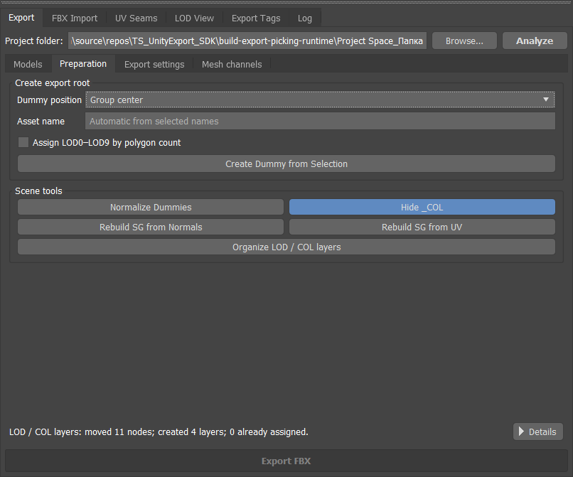
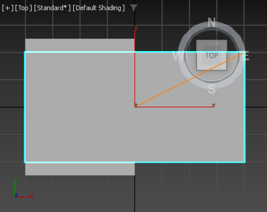
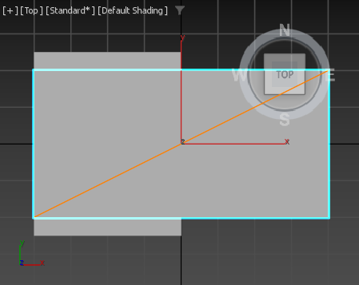
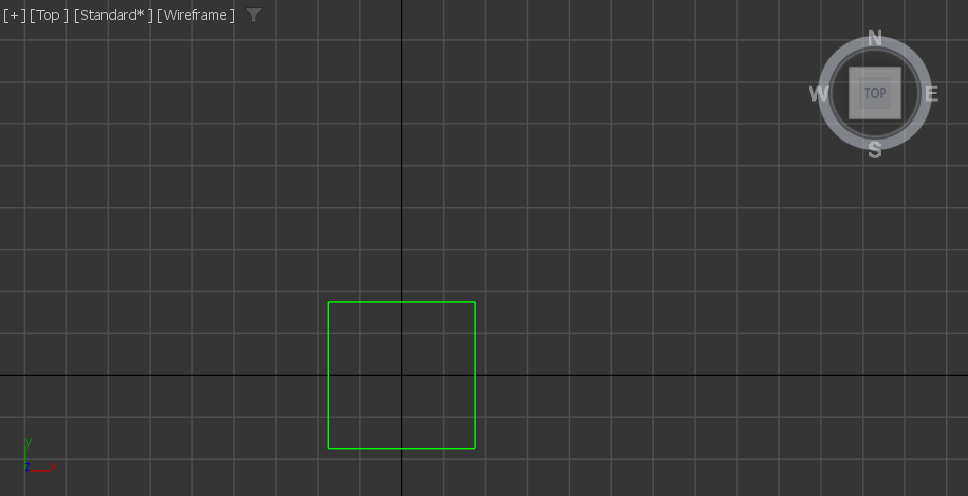
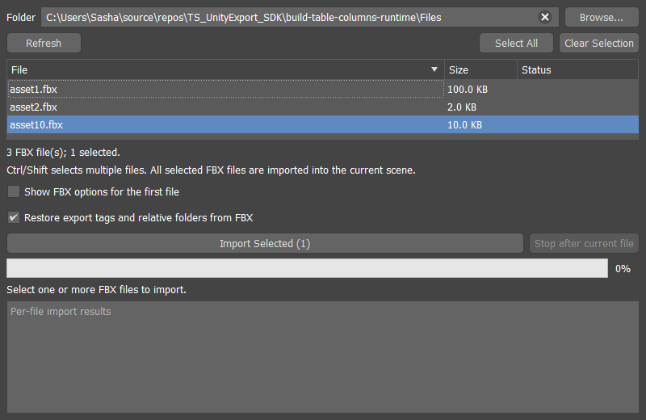
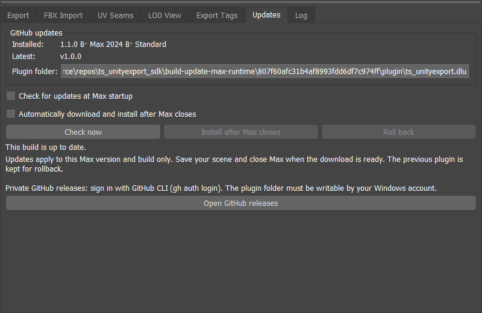

# MAX ModelBatch: руководство с иллюстрациями

**Версия 1.3.8 · 3ds Max 2022-2027 · FBX + дополнительный GLB · примеры из Max 2024**

Плагин помогает импортировать, готовить и экспортировать модели через панель Max: создавать корневые Dummy, сохранять отдельный FBX для каждой модели, импортировать файлы пачкой, сравнивать UV-швы, просматривать LOD и распределять модели по папкам проекта с помощью маршрутов SubPath. FBX можно использовать в Unity и других инструментах; согласование осей Unity включается отдельно.

В версии 1.3.8 маршруты экспорта SubPath отделены от пользовательских Tags в именах. Выбранная внутренняя вкладка сохраняется после перезапуска Max. Настройки экспорта и Viewport сохраняют компактные колонки из 1.3.5, которые переходят в столбец на узкой панели. Счётчики швов размещены в строку. Сохранены нативные заголовки Max и независимое состояние разделов; viewer останавливается до завершения Max. Снимки Export settings и Viewport ниже сделаны в 1.3.5 в Max 2024; эта компоновка сохранена в 1.3.8. Снимок Models сделан в 1.3.4, остальные рабочие процессы - в 1.2.0 и могут содержать прежние названия. Сохранены Dummy по пивоту LOD0, восстановление вкладки, настройки и данные сцен. Имена, пути и галочки на снимках служат примерами.

Названия кнопок и вкладок ниже оставлены на английском, как в интерфейсе плагина, чтобы их было проще найти.

## Содержание

- [1. Установка и открытие](#install)
- [2. Первый экспорт](#quickstart)
- [3. Dummy, имена и подготовка](#preparation)
- [4. Таблица экспортируемых моделей](#models)
- [5. SubPath, теги имён и папки проекта](#tags)
- [6. Настройки экспорта](#settings)
- [7. Масштаб и направления Unity](#unity)
- [8. UV-каналы и цвета вершин](#channels)
- [9. Отображение UV-швов](#seams)
- [10. Просмотр LOD и общие слои](#lod)
- [11. Пакетный импорт FBX](#import)
- [12. Обновление и откат](#updates)
- [13. Mesh Align: дополнительная сборка](#meshalign)
- [14. GLB / meshopt: дополнительная сборка](#glb)
- [15. Сохранение настроек и частые вопросы](#help)

<a id="install"></a>
## 1. Установка и открытие

1. Открой [релиз 1.3.8](https://github.com/SashaRX/MaxModelBatch-Releases/releases/tag/v1.3.8). Выбери архив **для своего года Max**. Для Max 2024: [скачать стандартную сборку](https://github.com/SashaRX/MaxModelBatch-Releases/releases/download/v1.3.8/MaxModelBatch_v1.3.8_3dsMax2024.zip).
2. Закрой Max. Распакуй архив в постоянную папку, например `C:\Tools\MaxModelBatch\2024`. Основной файл - `MaxModelBatch.dlu`. В исторических релизах до 1.2.0 включительно он назывался `TS_UnityExport.dlu`.
3. В Max открой **Customize → Configure System Paths → 3rd-Party Plug-Ins → Add**. Добавь папку с `.dlu` и перезапусти Max.
4. Открой **Scripting → MAX ModelBatch** на **Max 2022-2024**, либо **MAX ModelBatch → MAX ModelBatch** на **Max 2025-2027**. Резервное меню на старых версиях Max также называется **MAX ModelBatch**. В опубликованной сборке **1.2.0** команда ещё называется **Unity FBX Exporter** и находится в **Scripting** или **Unity Tools**.

При первом обновлении после переименования репозитория закрой Max и вручную замени установку. Удали `TS_UnityExport.dlu` из всех папок, которые Max сканирует при поиске плагинов, перед установкой `MaxModelBatch.dlu`. Для каждого года Max должна остаться одна подходящая копия. Настройки и маршруты SubPath существующих сцен сохраняются.

На странице [Скачать](/ru/downloads/#modelbatch) выбери **Standard**, **Mesh Align**, **GLB** или **Mesh Align + GLB**. Standard содержит FBX, UV, LOD, импорт и маршруты SubPath. Mesh Align экспериментальный. Для GLB нужен соответствующий отдельный Tools ZIP; см. [настройку GLB](#glb). Не смешивай годы Max и варианты плагина/worker. Qt поставляется с Max, дополнительные Qt DLL не нужны. Публичные ZIP скачиваются без аккаунта GitHub.

Панель можно закрепить в удобной области окна Max. На вкладке **Export** папка проекта и **Analyze** находятся сверху, **Export FBX** - снизу. Между ними две страницы: **Models** (создание Dummy, Scene tools и список) и **Export settings** (Geometry / pivots, FBX / Unity и Mesh channels). Нажми заголовок раздела, чтобы свернуть или раскрыть его; это не выключает инструменты внутри. Закреплённая вкладка восстанавливается после перезапуска; явное закрытие панели сохраняется.


*Models: создание Dummy, сворачиваемые Scene tools и список экспорта. Analyze заполняет список.*

<a id="quickstart"></a>
## 2. Первый экспорт

Для одного ассета собери визуальные меши и коллизии под одним Dummy. Если такая иерархия уже есть, переходи сразу к Analyze.

Шаги соответствуют публичным архивам **1.3.8** и обновлённому PDF. Models, Export settings и Viewport показывают текущую компоновку; на остальных снимках могут быть прежние названия.

1. Выдели меши одной модели в Max. Открой **Export → Models**.
2. Введи понятную основу в **Asset name**, например `TrashCan`. Переключи **At center / At bottom / At LOD0 pivot**, при необходимости включи **Auto LODs** и нажми **Create Dummy** над списком моделей.
3. Укажи **Project folder** - общую папку, относительно которой будут рассчитываться пути маршрутов SubPath.
4. Нажми **Analyze**. Если выделены объекты, анализируются их корни Dummy. Если ничего не выделено, плагин ищет Dummy по всей сцене.
5. На странице **Models** проверь имена, **Destination** и галочки корней. При необходимости назначь маршрут SubPath в последнем столбце.
6. Проверь **Export settings**, включая раздел **Mesh channels**. Нажми **Export FBX**.
7. Посмотри результат операции снизу и открой **Details** или **Updates / Log → Log**, если есть ошибки.

<a id="compact-ui"></a>
### Компактные элементы Dummy в 1.3.8

**Asset name**, **At center / At bottom / At LOD0 pivot**, **Auto LODs** и **Create Dummy** находятся прямо над списком Models. Инструменты сцены находятся в **Models → Scene tools**. Правила имён, положение геометрии и отмена одним Ctrl+Z сохраняются. В прежних сборках 1.2.1 создание было в **Export → Preparation → Create Dummy from Selection**.

Каждый отмеченный корень, видимый через текущий фильтр маршрутов SubPath, экспортируется в отдельный файл с именем Dummy: например `SM_TrashCan.fbx`. В файл входит его иерархия, включая `_COL`.

Пример структуры одного ассета:

```text
SM_TrashCan                 ← экспортный корень, имя файла
├── TrashCan_LOD0            ← самый подробный вариант
├── TrashCan_LOD1
├── TrashCan_LOD2
└── TrashCan_COL             ← коллизия
```

LOD не нужно включать для каждой детали составной модели. Используй LOD-ранжирование, когда выбранные объекты или группы представляют альтернативные уровни детализации одного ассета.

<a id="preparation"></a>
## 3. Dummy, имена и подготовка



*Исторический снимок 1.2.0: создание Dummy было в Preparation. В 1.3.8 оно находится над списком Models; инструменты сцены находятся в Models → Scene tools. Organize export layers работает со всей сценой.*

**At center / At bottom / At LOD0 pivot** задаёт точку корня:

| Режим | Где окажется Dummy |
|---|---|
| At center | В центре общего bounding box геометрии выбранной иерархии |
| At bottom | В том же центре по X/Y, но на нижней границе геометрии по Z |
| At LOD0 pivot | Мировая позиция пивота единственного именованного объекта/группы LOD0; с Auto LODs - самой детальной альтернативы |

Без Auto LODs отсутствие или неоднозначность LOD0 останавливает операцию без изменений сцены. Ветки коллизий исключены; именованная группа LOD0 задаёт пивот для своего поддерева. Копируется только позиция: геометрия остаётся на месте, вращение и масштаб корня единичные.

«У пола» означает низ выбранной модели, а не мировой `Z = 0`. Положение видимой геометрии при создании корня сохраняется.

В **Asset name** можно явно задать общую основу имени. Если оставить поле пустым, плагин ищет информативное имя среди выделенных объектов. Автоматический выбор использует эвристики; когда подходящей основы нет, появится запрос имени. Явное имя удобнее, если в сцене остались `Plane003`, числовые или временные названия.

Корень получает `SM_`, но не постфиксы `_COL` и `_LOD#`: `SM_TrashCan`. У дочерних объектов `SM_` убирается. **Auto LODs** присваивает всем LOD общую основу: больше полигонов - меньший номер; при равенстве учитывается порядок выделения. Выбранная группа считается по сумме её render-мешей. Коллизии исключаются из ранжирования и сохраняют `_COL`. Автоматическое ранжирование рассчитано максимум на десять LOD-вариантов.

Создание Dummy, переименование и переподчинение отменяются одним **Ctrl+Z**.

Инструменты сцены:

| Кнопка | Действие |
|---|---|
| Normalize Dummies | Приводит размеры бокса всех Dummy к 1×1×1 |
| Hide _COL | Скрывает коллизии по суффиксу `_COL`; повторное нажатие показывает их |
| Rebuild SG from Normals | Восстанавливает smoothing groups выделенных Editable Poly/Mesh по готовым нормалям |
| Rebuild SG from UV | Восстанавливает smoothing groups выделенных Editable Poly/Mesh по UV-швам Max channel 1 базового объекта |
| Organize export layers | Раскладывает объекты всей сцены по общим слоям LOD0, LOD1, … и COL |

Для **Rebuild SG from UV** UV должны быть в базовом объекте: если они находятся только в модификаторе Unwrap/UVW Mapping, сначала подготовь стек. Этот инструмент меняет сглаживание; он отличается от просмотра UV-швов, который сцену не меняет.

<a id="models"></a>
## 4. Таблица экспортируемых моделей


*В раскрытой иерархии видны Dummy, дочерние объекты и предполагаемые результаты разделения материалов.*

- **Галочка у корня** включает его в экспорт. Она отличается от обычного выделения строки.
- Клик по **Name**, **Status** или **Destination** выделяет соответствующий объект в Max. Dummy выделяется вместе со всеми потомками, даже когда ветка свёрнута. Клик по обычному мешу выбирает сам меш.
- **Ctrl/Shift** позволяют выделять несколько строк. Столбец **SubPath** открывает выпадающий список назначения маршрута SubPath и не меняет выделение сцены.
- После **Analyze** ветки свёрнуты. **Развернуть всё / Свернуть всё** переключает все уровни показанных иерархий.
- **All / None / Invert** меняют экспортные галочки только у моделей, видимых через фильтр маршрутов SubPath. Скрытые фильтром модели сохраняют свои галочки.
- Потяни границу столбца, чтобы изменить ширину; двойной клик по границе подбирает её по содержимому. Клик по заголовку сортирует строки, повторный клик меняет порядок. Дочерние объекты остаются под своим корнем.

**Split materials** разделяет render-меши с Multi/Sub материалами на меши по материалам. Analyze заранее показывает предполагаемые результаты. Кнопка обрабатывает **все показанные фильтром модели, независимо от экспортных галочек**. Строка предполагаемого результата ещё не является объектом сцены, поэтому до разделения её нельзя выбрать во viewport.

Analyze заполняет список, но сам по себе не экспортирует и не выполняет Split.

<a id="tags"></a>
## 5. SubPath, теги имён и папки проекта

**SubPath** выбирает папку экспорта Dummy. **Tags** добавляет слова в имена объектов. Оба инструмента находятся на вкладке **SubPath / Tags**, но их назначения независимы.


*SubPath / Tags в предрелизной тестовой сборке для Max 2024: сверху маршруты экспорта, снизу действия с именами. Этот layout сохранён в 1.3.8.*

### Выбери маршрут экспорта SubPath

Прежний экспортный Tag теперь называется **SubPath**. Сохранённые ключи, папки, цвета и назначения продолжают работать. У одного Dummy один маршрут для всей иерархии.

1. Задай общую **Project folder**, например `D:\Game\Assets`.
2. Открой **SubPath / Tags → SubPath → Add subpath**. Введи ключ, например `props`.
3. Для **Relative folder** нажми **Browse...** и выбери папку внутри проекта. При выборе `D:\Game\Assets\Models\Props` сохранится `Models/Props`.
4. Выбери цвет и подтверди. Назначь маршрут через столбец **SubPath** на **Export → Models**. Для нескольких корней выдели строки и используй правый клик → **Assign export subpath to selected roots**.

```text
Project folder     D:\Game\Assets
SubPath            props
Relative folder    Models/Props
Dummy              SM_TrashCan
Result             D:\Game\Assets\Models\Props\SM_TrashCan.fbx
```

Экспорт создаёт недостающие относительные папки. Папка вне проекта не принимается. **No subpath** отправляет FBX непосредственно в Project folder. Если корень уже указывает на `Assets`, не добавляй `Assets` повторно в относительный путь.

**Edit path / color** меняет маршрут и цвет, сохраняя ключ. Цвет используется как подложка имён в списке и как цвет Dummy во viewport. Удаление определения оставляет его назначения видимыми как отсутствующие: перед экспортом восстанови или переназначь их. Одинаковые итоговые имена файлов блокируют пакет до записи.

Открой **SubPath filter**, чтобы показать несколько маршрутов вместе, при необходимости включая **No subpath**. **All models** показывает все корни, а снятие всех пунктов даёт пустой список. Сохрани `.max`, чтобы сохранить фильтр и экспортные галочки.

User Defined Properties Dummy и экспортируемый FBX содержат маршрут, относительную папку и цвет. Копии сохраняют их. **Restore export subpaths and relative folders from FBX** восстанавливает определения при FBX Import; конфликтующие маршруты получают отдельные ключи. Абсолютную папку принимающего проекта задай отдельно.

<a id="name-tags"></a>
### Добавь пользовательские теги в имена

Выдели нужные объекты в Max, введи теги, например `Wood, Wet` или `PM_Concrete`, и нажми **Add tags**:

```text
Chair_LOD0       → Chair_Wood_Wet_LOD0
Chair_COL        → Chair_Wood_Wet_COL
Chair_LOD2_COL   → Chair_Wood_Wet_LOD2_COL
```

**Remove tags** удаляет введённые управляемые теги, а **Clear tags** очищает все теги, добавленные этим инструментом. Повторное добавление не дублирует тег. Меняются только выделенные узлы: команда не расширяет выделение на дочерние объекты или экспортные корни. Конфликт итоговых имён отменяет весь пакет.

Тегами можно обозначить тип физического материала или другие правила проекта. Они меняют имена, а не назначенные материалы. Используй латинские буквы, цифры и одиночные подчёркивания. Несколько тегов разделяй запятыми, пробелами или точкой с запятой. `COL`, `LOD` и LOD с номером зарезервированы для структурных постфиксов.

Один **Undo/Redo** восстанавливает имена вместе с метаданными тегов. Сохрани сцену, чтобы оставить их в `.max`. Очистка сохраняет обычную авторскую часть имени: слова, написанные вручную, не угадываются как управляемые теги. Auto LOD сохраняет теги каждого объекта перед новым постфиксом LOD и исключает их при определении базового имени Dummy.

<a id="settings"></a>
## 6. Настройки экспорта


*Export settings: Geometry / pivots слева, FBX / Unity справа, Mesh channels ниже на всю ширину. На узкой панели колонки переходят в столбец; каждый нативный раздел сворачивается независимо.*

| Опция | Когда нужна и что меняет |
|---|---|
| Center mesh pivots | Центрирует pivot render-мешей по геометрии. Pivot `_COL` привязывается к экспортному Dummy независимо от этой галочки |
| Reset XForm + collapse | Запекает rotation/scale мешей и схлопывает стек. Выключи, если нужно сохранить авторские Transform на мешах |
| Move export roots to origin | Экспортирует корни у начала координат; исходное положение восстанавливается после операции |
| Reset organizer rotation / scale | Убирает rotation/scale организационных Dummy при экспорте. Выключи для сохранения авторских трансформаций |
| Weighted normals | Временно применяет Weighted Normals к render-мешам; `_COL` пропускается |
| Clean FBX metadata | Очищает лишние данные FBX, сохраняя нужные для сцены и маршрутизации |
| Keep overwritten FBX backup | Сохраняет `.fbx.bak` при перезаписи существующего файла |
| Strip tangents / binormals | Оставляет пересчёт тангентов Unity; по умолчанию включено |
| Match Unity view axes | Согласует направления модели с Unity; подробнее ниже |

Подготовка pivot/Reset XForm может оставаться в сцене и иметь Undo. Экспортные временные изменения положения корней и коллизий восстанавливаются. Плагин экспортирует статические иерархии моделей, а не анимацию или риги. Для повторной работы со стеком учитывай, что **collapse** меняет исходный объект.

<a id="unity"></a>
## 7. Масштаб и направления Unity

Проектная договорённость: **1 System Unit в Max = 1 метр**. Экспортируемый FBX использует метры. Если старая сцена имеет другие System Units, плагин переводит расстояния в метры при записи. Он не переключает единицы самой сцены. **Display Units** меняют представление чисел, а не физический размер.

Для проверки масштаба создай объект шириной 1 метр и сравни его после импорта в Unity с кубом размером 1 Unity unit. Сравни реальные габариты: значение Transform Scale само по себе не доказывает правильный размер.


*Match Unity view axes включён; Unity axis bake на этом примере установлен в On.*

Чтобы направления совпали:

1. Включи **Export → Export settings → Match Unity view axes**.
2. Выбери **Unity axis bake: Off/On** в соответствии с **Bake Axis Conversion** в Model Import Settings этого FBX в Unity.
3. Повторно экспортируй и переимпортируй FBX после изменения настройки.

| Вид/направление Max | Ось Max | Направление Unity |
|---|---|---|
| Front | -Y | +Z |
| Back | +Y | -Z |
| Top | +Z | +Y |
| Bottom | -Z | -Y |
| Right | +X | +X |
| Left | -X | -X |

Согласование по умолчанию выключено. Оно применяется при экспорте модели и Transform, а не поворачивает viewport и не создаёт живую связь с Unity. Для проверки удобна асимметричная модель с метками Front/Top/Right. При чистом исходном корне и включённой нормализации ожидаются нулевая rotation и Scale `(1,1,1)`; авторские трансформации могут сохраняться, если соответствующие Reset-опции выключены.

<a id="channels"></a>
## 8. UV-каналы и цвета вершин

Открой **Export → Export settings → Mesh channels** и раскрой раздел.


*Mesh channels: включение каналов, имена FBX и константы U/V. На снимке сохранён пример с Override у UV2.*

- Галочки **UV0-UV3** выбирают, какие UV-каналы записывать в FBX. **UV0 соответствует Max channel 1**, UV1 - channel 2, и далее по порядку.
- **FBX name** задаёт имя слоя; пустое поле использует имя выбранного **Naming style**.
- **Override** заменяет данные включённого канала одной константой **U/V** для всех углов полигонов. Например, это удобно для передачи параметра шейдеру через отдельный UV-канал.
- Без Override константа используется только для заполнения отсутствующих данных канала.
- **Vertex Color / Vertex Alpha** включают соответствующие данные render-мешей. Коллизии `_COL` экспортируются без этих дополнительных каналов.

На чистых настройках UV0 включён; UV1-UV3, Vertex Color и Vertex Alpha выключены. Настройки сохраняются, поэтому на рабочем компьютере галочки могут отличаться. Включи UV1, если второй UV-набор должен попасть в экспорт.

<a id="seams"></a>
## 9. Отображение UV-швов


*В Viewport LOD preview и scope остаются на всю ширину. UV seams слева; UV1 checker и Display справа друг под другом. Счётчики швов собраны в строку. На узкой панели разделы переходят в один столбец без изменения настроек функций.*


*UV Seams: каналы, область объектов, Depth test, частота обновления и цвета. Здесь показан режим Both с Only differences.*

1. Открой **Viewport → UV seams** и включи **Show UV seams**.
2. В **Channels** выбери **UV0 (Max channel 1)**, **UV1 (Max channel 2)** или **Both (compare)**.
3. В **Objects** выбери **Selected objects** либо **All visible objects**.
4. Настрой **Depth test**, **Only differences** и палитру.

| Цвет по умолчанию | В Both (compare) | При просмотре одного канала |
|---|---|---|
| Голубой | Шов только UV0 | Все швы UV0 |
| Оранжевый | Шов только UV1 | Все швы UV1 |
| Зелёный | Общий шов UV0 и UV1 | Не используется отдельно |

**Only differences** скрывает общие швы только при сравнении Both. Открытые границы также считаются швами. Кнопки **UV0**, **UV1**, **Common** в Colors позволяют выбрать свои цвета; **Reset colors** восстанавливает палитру.

**Hide occluded seams (Depth test)** скрывает линии за поверхностью модели. Выключи его для просмотра швов насквозь.



*Depth test включён: оранжевая диагональ за передней поверхностью не видна.*



*Depth test выключен: диагональ рисуется целиком. В HTML-версии эти два состояния можно переключать.*

**Refresh interval** задаёт минимальный интервал между запланированными обновлениями после изменений: **16-2000 ms**, по умолчанию **100 ms**. Это не непрерывный опрос сцены в простое. Меньший интервал быстрее показывает правки; больший уменьшает нагрузку. Если сцена тяжёлая, попробуй 200-500 ms и область Selected objects. **Refresh** принудительно обновляет снимок; **Details** раскрывает причины пропуска объектов или проблем UV.

Швы читаются из вычисленного стека модификаторов, работают при редактировании Editable Poly и с Unwrap UVW. Просмотр не требует Collapse и не меняет меш. После включения швы продолжают отображаться при переключении вкладки и закрытии панели. Для режима одного канала не требуется наличие второго UV-набора.


*Другой способ включения: меню режима shading во viewport → UV Seams, под Edged Faces. Оно использует то же состояние, что Show UV seams.*

<a id="lod"></a>
## 10. Просмотр LOD и общие слои

### Просмотр одного уровня

В **Viewport → LOD preview** выбери **LOD0**, **LOD1**, … из списка найденных уровней. **Previous / Next** переходят между существующими уровнями, пропуская отсутствующие. **All LODs** возвращает обычное отображение сцены.

LOD определяется по именам **объектов или групп**, например `Tree_LOD0`, `Tree_LOD1`, `Tree_LOD12`. Потомки наследуют ближайшего именованного предка; собственная метка LOD у дочернего объекта имеет приоритет. Просмотр поддерживает номера выше 9, хотя автоматическое переименование при создании Dummy ограничено LOD0-LOD9.


*All LODs: внизу красный LOD0, зелёный LOD1, синий LOD2; сверху два объекта без LOD-имени.*



*Выбран LOD1; Show objects without LOD names выключен. В HTML можно переключить All, LOD0, LOD1 и LOD2.*

**Show objects without LOD names** оставляет видимыми объекты без метки LOD. Режим просмотра продолжает работать с закрытой панелью и не снимает существующие Hide-состояния объектов/слоёв. После замены сцены режим возвращается к All LODs. UV-швы учитывают текущий LOD-просмотр.

### Распределение по слоям

В **Export → Models → Scene tools** нажми **Organize export layers**. Кнопка работает **со всей сценой**, независимо от выделения, экспортных галочек и фильтра маршрутов SubPath:

- создаёт отсутствующие общие слои `LOD0`, `LOD1`, … и `COL`;
- распределяет объекты по их именам и наследуемым меткам;
- помещает ветки `_COL` в `COL`, даже если выше есть LOD-метка;
- сохраняет настройки существующих слоёв; **Ctrl+Z** отменяет операцию.

Просмотр LOD временно фильтрует viewport. Организация слоёв меняет принадлежность объектов к слоям сцены. Для экспорта нужных моделей используй Models: LOD-просмотр сам по себе не выбирает состав экспортного файла.

<a id="import"></a>
## 11. Пакетный импорт FBX



*FBX Import: папка, таблица файлов, настройки и Import Selected. Размеры и имена файлов на снимке тестовые.*

1. Открой **FBX Import** и выбери **Folder → Browse...**.
2. Выдели один или несколько файлов через **Ctrl/Shift**; **Select All** выделяет весь список, **Clear Selection** снимает выделение.
3. При необходимости включи **Show FBX options for the first file**. Нативный диалог импорта Max откроется для первого доступного файла, чтобы настроить пакет.
4. Оставь **Restore export subpaths and relative folders from FBX** включённым, если импортируешь модели с маршрутами SubPath этого плагина.
5. Нажми **Import Selected**. Все файлы добавляются **в текущую сцену**. Результаты видны в Status и отчёте снизу.

**Refresh** перечитывает папку. **Stop after current file** останавливает пакет после завершения текущего файла. Заголовки сортируют таблицу; ширина столбцов настраивается вручную. Импорт использует настройки FBX-импортера Max; отдельные `.max` для каждого файла не создаются.

<a id="updates"></a>
## 12. Обновление и откат

На вкладке **Updates / Log** находятся действия обновления и сворачиваемый **Log** с Copy, Clear и Auto-scroll.

**Публичное обновление вручную:** скачай ZIP 1.3.8 для своего года Max и набора функций на странице [Скачать](/ru/downloads/#modelbatch). Сохрани сцену, закрой Max, замени установленный `.dlu` и перезапусти Max. Для GLB также установи соответствующий пакет инструментов. Аккаунт GitHub для публичных архивов не нужен.

**Встроенный автообновитель по-прежнему использует закрытый репозиторий разработки.** Для его действий нужны `gh auth login` с доступом к репозиторию и папка плагина, доступная для записи. Публикация ZIP не меняет это требование.



*Исторический снимок Updates из прежней тестовой сборки. В 1.3.8 используются компактные названия ниже; версии и пути на снимке служат примерами.*

1. Открой **Updates / Log → Check now**.
2. Если доступно обновление, нажми **Install update**. Плагин скачает и проверит пакет для своего года Max и варианта сборки.
3. Когда всё готово, сохрани сцену и закрой Max. Установка выполняется после выхода процесса.
4. Запусти Max после завершения установки. Проверь **Installed**, вариант сборки и **+ GLB**, если он включён.

**Check at startup** включает проверку при запуске. **Download and install after closing Max** также включает стартовую проверку и автоматически готовит совместимые обновления. По умолчанию обе опции выключены.

**Roll back** подготавливает восстановление предыдущего файла после закрытия Max. **Retry install** повторяет подготовленную установку, если другой процесс помешал замене. Предыдущая версия сохраняется для отката.

Цвет текста различает информацию/прогресс, успех/актуальную версию, предупреждения/доступное обновление и ошибки; смысл также указан словами. **Plugin file** доступен только для чтения, полный путь виден в подсказке. **Website / guide** открывает это публичное руководство.

При переходе с `TS_UnityExport.dlu` один раз установи переименованный плагин вручную и убери старые копии из папок плагинов. Для каждого года Max оставь одну подходящую копию. Горячей замены нет.

<a id="meshalign"></a>
## 13. Mesh Align: дополнительная сборка

Вкладка **Mesh Align** появляется в архивах `_MeshAlign.zip` и `_MeshAlign_GLB.zip`. Она помогает согласовать плоскости и границы соседних модульных Editable Poly. Это дополнительный инструмент работы с геометрией, не обязательный этап FBX-экспорта.

1. Выдели модульные меши и нажми **Analyze selection**: найдутся плоские области и общие кластеры плоскостей.
2. Проверь результаты; двойной клик по области или кластеру подсвечивает соответствующие полигоны.
3. **Project all clusters / Project selected clusters** проецируют вершины на согласованные плоскости.
4. **Weld borders (all clusters) / Weld borders (selected clusters)** совмещают позиции граничных вершин с учётом этих плоскостей.

Analyze и подсветка не меняют геометрию. Project/Weld перемещают существующие вершины и имеют Undo; они не объединяют объекты и не добавляют/удаляют полигоны. Для операций изменения требуется базовый Editable Poly без стека модификаторов. Параметры расстояний относительные к bounding box выделения. UV-aware welding пока не реализован.

<a id="glb"></a>
## 14. GLB / meshopt: дополнительная сборка

Вкладка **GLB / meshopt** входит только в сборки `_GLB.zip` и `_MeshAlign_GLB.zip`. Стандартная и Mesh Align без GLB сохраняют сценарии FBX.

1. На странице [Скачать](/ru/downloads/#modelbatch) возьми плагин и соответствующий `_GLB_Tools.zip` или `_MeshAlign_GLB_Tools.zip` для **одинаковых версии 1.3.8, года Max и набора функций**.
2. Распакуй инструменты в постоянную папку с правом записи. Сохрани манифесты и лицензии. В настройках GLB выбери её `gltfpack.exe` и `MaxModelBatchGlbWorker.exe`: worker должен соответствовать сборке плагина. При каждом обновлении GLB-плагина обновляй и инструменты.
3. В **Scene export** анализируй корни Dummy, применяй общие маршруты SubPath/фильтр, отмечай модели и экспортируй текущую вычисленную статическую геометрию, включая несохранённые правки. Захват GLB не запускает FBX-подготовку pivot и не схлопывает стек сцены.
4. **Pack existing GLB** работает с готовыми файлами. Перед использованием оптимизированного результата проверь профиль совместимости и отчёт проверки в целевом приложении.

GLB использует метры и правую систему Y-up / -Z forward. Неподдерживаемые skin/morph, анимация, материалы и карты дают отчёт. Для meshopt-сжатия нужен совместимый декодер. Дополнительные meshlet-пакеты содержат обычный GLB, отдельный версионированный файл и манифест; им нужна поддержка потребителя, они сами не включают GPU-рендеринг или игровое поведение. Оставляй профиль совместимости по умолчанию, пока поддержка выбранных опций целевым загрузчиком не подтверждена.

Автообновитель заменяет только плагин, а не отдельную установку инструментов. Использование meshlet в рабочей игре/GPU пока ожидает проверки.

<a id="help"></a>
## 15. Сохранение настроек и частые вопросы

### Что запоминается

| Данные | Где сохраняются |
|---|---|
| Project folder, определения маршрутов SubPath, выбранный фильтр, экспортные галочки | В `.max` после сохранения сцены |
| Маршрут SubPath, относительный путь, цвет модели | В User Defined Properties Dummy и в экспортируемом FBX |
| Ширина и сортировка таблиц, параметры экспорта, UV-палитра/интервал, Updates | В пользовательских настройках плагина |
| Определения маршрутов SubPath для новых сцен того же проекта | Дополнительно запоминаются для проекта |

Панель также запоминает выбранную внутреннюю вкладку. Если необязательной вкладки нет в сборке, открывается Export. Парковка панели и состояния сворачиваемых разделов сохраняются независимо.

### Если что-то не работает

| Симптом | Что проверить |
|---|---|
| Analyze показывает не все модели | Сними выделение в Max для анализа всей сцены; проверь корни Dummy и SubPath filter |
| Export FBX неактивна | Задана ли Project folder, есть ли показанные корни с галочками, не пуст ли фильтр |
| Швы не видны | Show UV seams, нужный канал, область Selected/All visible, текущий LOD, Hide-состояния и Details |
| Общие UV-швы пропали | Выключи Only differences в режиме Both |
| Обновление UV заметно задерживается | Уменьши Refresh interval; для тяжёлой сцены ограничь показ Selected objects |
| Dummy имеет другой цвет | Проверь маршрут SubPath/цвет, состояние выделения/заморозки и загруженную сборку; после ручной замены `.dlu` нужен перезапуск |
| Экспорт заблокирован маршрутом SubPath | Восстанови отсутствующее определение или назначь существующий маршрут SubPath/No subpath |
| Два объекта экспортируются в один путь | Измени имя корня или папку маршрута SubPath; одинаковые назначения блокируют пакет |
| Размер или Front в Unity неверны | Проверь System Units, реальный размер модели и совпадение Unity axis bake с Bake Axis Conversion |
| После замены файла работает старый интерфейс | Закрой Max, проверь, что зарегистрирована одна копия `.dlu` для нужного года, затем перезапусти |

**Details** показывает полный отчёт текущей операции, а **Log** помогает понять причину ошибки. Некорректные имена файлов, нулевой scale и неподдерживаемые Transform могут блокировать экспорт до исправления сцены.

Для проверки новой сборки на Max 2024 пройди короткий маршрут: создание Dummy → Analyze → назначение маршрута SubPath → экспорт одного FBX → импорт → Viewport (UV seams / LOD preview). Затем сохрани и открой `.max`, чтобы проверить сохранение фильтра, галочек и маршрутов SubPath.

Технические материалы в репозитории плагина, доступные при наличии доступа к нему: [UV-швы](https://github.com/SashaRX/MaxModelBatch/blob/main/docs/UV_SEAMS.md), [маршруты SubPath экспорта](https://github.com/SashaRX/MaxModelBatch/blob/main/docs/EXPORT_TAGS.md), [создание Dummy](https://github.com/SashaRX/MaxModelBatch/blob/main/docs/DUMMY_CREATION.md), [оси Unity](https://github.com/SashaRX/MaxModelBatch/blob/main/docs/UNITY_AXES.md), [единицы измерения](https://github.com/SashaRX/MaxModelBatch/blob/main/docs/EXPORT_UNITS.md), [обновления](https://github.com/SashaRX/MaxModelBatch/blob/main/docs/UPDATES.md), [Mesh Align](https://github.com/SashaRX/MaxModelBatch/blob/main/docs/MESHALIGN.md).
